# Availability under disruption: Eureka → Kubernetes Services → replicas and graceful shutdown

This report covers assignment tasks 5, 7, 8 and 9: measuring the initial state, choosing replicas from measured memory, adding graceful shutdown and reviewing the probes, then measuring again. The scripts are described in [README.md](README.md). Generated per-version summaries are in `results/<label>/summary.md`, and the cross-version tables are in [results/comparison.md](results/comparison.md).

## Summary

Three versions of the application were measured under the same load (30 reads/s + 1 login/s, from `kube01`) against the same disruptions: a CI-style rollout of every Deployment, pod deletion (graceful and forced), and the drain of an agent. Each cell has 3 runs.

| disruption | baseline (Eureka) | after task 6 (Services) | after tasks 7+8 |
|---|---|---|---|
| rollout of every Deployment (`update`) | 2861 failed requests, 119 s longest error window | 896, 48 s | **247 (1–733), 18 s** |
| one pod of **gateway** deleted (`kill1`) | 699, 24 s\* | 545, 19 s\* | **0** |
| one pod of **user-service** deleted (`kill1`) | 2098, 69 s\* | 1162, 38 s\* | **0** |
| one gateway pod force-deleted (`crash1`) | 754, 25 s\* | 495, 17 s\* | **0** |
| every pod of user-service deleted (`kill`) | 2098, 69 s | 1162, 38 s | 775, 26 s |
| single-replica library deleted (`kill`) | 713, 72 s | 325, 33 s | 255, 27 s |
| drain of the non-Postgres agent | 2747, 95 s | 1520, 54 s | 1218, 50 s |
| no disruption, 10 min (`steady`) | 36 | 1 | 2 |

\* single replica: deleting one pod is deleting all of them.

- **Removing Eureka (task 6)** removed the stale-registry errors. In the baseline, failures continued 36–41 s after the replacement pod was ready; after task 6, at most one circuit-breaker window (≤ 10 s).
- **Two replicas of gateway and user-service, with preStop and graceful shutdown (tasks 7+8),** made a single-pod failure of either one invisible to clients: 0 failed requests in 9 runs, and the circuit breaker never opened. preStop also keeps old pods answering for 10 s when every pod of a service goes at once, but only behind kube-proxy, not behind Traefik.
- **What remains:** services with one replica still have an outage of ~25–35 s when their pod goes. `update` can still fail when fresh, cold pods take traffic on CPU-saturated agents (1 of 3 runs). The spread constraint as first deployed put both replicas on one agent in half the runs, which made steady-state latency worse (fixed in `7970a6b`, [verified](#placement-and-steady-state-latency)). Postgres is a single point of failure.
- **Memory** never constrained the choice: two replicas of gateway and user-service cost ~420 MiB against ~14.8 GiB usable per agent.

## Setup

| | |
|---|---|
| Cluster | k3s v1.36.5+k3s1 on Ubuntu 26.04.1 (kernel 7.0.0-38). `kube01`: server only, tainted `CriticalAddonsOnly=true:NoExecute`. `kube02`, `kube03`: agents. |
| Node size | 2 vCPU (Xeon Gold 6240) and 15.1 GiB allocatable memory each. Not 4 GiB, as older notes say. |
| Ingress | Traefik (one pod, on `kube02`, the same node as `postgres-0`) behind ServiceLB on port 8080 of every node. All load enters at `http://10.100.50.11:8080`. |
| Database | One PostgreSQL 17 pod, `postgres-0`, on a local-path volume bound to `kube02`. |
| Load host | `kube01`, k6 v2.3.0. It shares 2 vCPU with the k3s server and a ServiceLB pod. The development machine (2 vCPU, 2 GB, reaching the cluster over a VPN that dropped twice during the work) was not usable as a load host. The clocks are NTP-synchronised, and all timestamps come from `kube01`. |
| Load | `RATE` = **30 reads/s** (round-robin `GET /api/books/booksAll`, `/api/lendings`, `/api/seats`) + 1 login/s, constant arrival rate, 10 s timeout, only HTTP 200 counts as success. |
| Runs | 7 cells × 3 runs per version, plus 3 single-pod cells × 3 runs for `after-task7-8`, `experiments/reset.sh` before each. A run is 30 s idle, then k6 for 6 min (10 min for `steady`): 90 s warm-up, the disruption, and the rest. The runs were interleaved by round. |
| Logging | Unchanged in every version: gateway `DEBUG` for `org.springframework.cloud.gateway` and `org.springframework.web`, user-service `show-sql: true`. Every request writes several log lines, and this cost is part of every number below. |

| Label | Commit | Images | What it is |
|---|---|---|---|
| `baseline-eureka` | `442f087` | `sha-442f087` | Last commit before the Eureka removal: gateway routes `lb://<service>` through the Eureka registry, plus an `eureka-server` pod. |
| `after-task6` | `dd8c8e5` | `sha-dd8c8e5` | Eureka removed. The gateway routes to Kubernetes Service names. The leftover `eureka-server` Deployment and Service were deleted by hand (`kubectl apply` does not prune). |
| `after-task7-8` | `6cf0d97` | `sha-6cf0d97` | Two replicas of gateway and user-service, PDBs, per-service spread, memory requests (task 7), graceful shutdown, preStop and probe timeouts (task 8). `6cf0d97` is `ba7675c` plus the fix of its topology spread (see [Incidents](#incidents-during-the-work)). |

### Choosing RATE

`calibrate.sh` ramped the load against warm pods of the baseline in 2-minute steps:

| rate/s | 10 | 20 | 40 | 60 | 100 | 150 | 200 | 250 | 300 | 400 |
|---|---|---|---|---|---|---|---|---|---|---|
| p95 ms | 58 | 33 | 24 | 25 | 20 | 34 | 64 | 604 | 7228 | 10001 |
| success | 100 % | 100 % | 100 % | 100 % | 100 % | 100 % | 100 % | 100 % | 99.7 % | 31 % |

p95 bends at 200/s, so the first choice was 100/s. That turned out wrong: the first baseline series at 100/s showed 31 % errors in **`steady`** and two restarts of user-service. Every run starts right after a reset with cold JVMs, and at 100/s the cold user-service hit its CPU limit. Its liveness probe (1 s timeout) then failed, and the kubelet restarted it twice. The two runs are kept in `results/calibration/rate100-baseline-eureka/`. A cold-start check (`reset.sh`, then 5 min at a fixed rate) gave:

| cold start | non-200 | p95 | restarts |
|---|---|---|---|
| 60/s | 75 (timeouts, mostly logins in the first minute) | 4.7 s | 0 |
| 40/s | 0 | 246 ms | 0 |

The `update` and `kill` scenarios also put fresh JVMs under load, so the cold-start limit is the one that applies. Half of the 60/s where errors appeared gives **RATE = 30/s**, used for every run of every version. The calibration also produced the first argument for task 8: at 300–400/s, liveness probes with the default 1 s timeout restarted loan and seat (warm pods, CPU-saturated).

## Results

Each cell gives the mean over 3 runs, with (min–max) where the runs differ. *Errors after ready* is how long non-200 responses continued after the replacement pod became ready. *Recovery* is the time from the disruption until the last second with an error. Latencies are for the read requests sent after the disruption started, which leaves out the cold warm-up after `reset.sh` (whole-run values are in `results/comparison.md`). A `*` marks a single-replica version shown in a single-pod cell: with one replica, `kill1` is the same as `kill`, so those rows repeat the `kill`/`crash` runs.

Status classes: **503** is the gateway's circuit-breaker fallback, or Traefik's "no available server" when no gateway pod is ready. **0** is a timeout (10 s) or a refused or reset connection. **Other** non-200 responses are almost all **403**, plus **502** (Traefik, during `update`). A 403 is what a reader gets when user-service cannot be reached: the reading service's `JwtFilter` cannot look the user up, so the request fails as *unauthenticated* instead of *unavailable*.

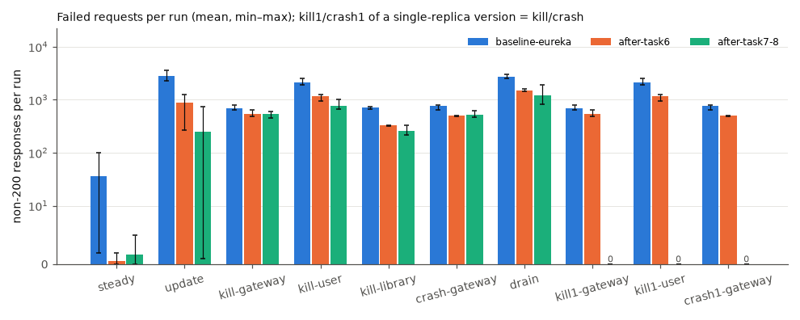

**steady**

| version | runs | non-200 | non-200 % | longest error window s | recovery s | p95 after start ms | p99 after start ms | restarts |
|---|---|---|---|---|---|---|---|---|
| baseline | 3 | 36 (2–100) | 0.20 (0.01–0.54) | 5 (1–10) | 2 (0–7) | 34 (26–40) | 253 (43–444) | 0 |
| task 6 | 3 | 1 (0–2) | 0.00 (0.00–0.01) | 1 (0–2) | 0 | 44 (26–60) | 335 (58–474) | 0 |
| tasks 7+8 | 3 | 2 (0–5) | 0.01 (0.00–0.03) | 1 (0–3) | 0 | 752 (26–1574) | 2278 (41–3983) | 0 |

**update**

| version | runs | non-200 | non-200 % | longest error window s | recovery s | p95 after start ms | p99 after start ms | rollout s | restarts |
|---|---|---|---|---|---|---|---|---|---|
| baseline | 3 | 2861 (2267–3547) | 26.17 (20.55–32.55) | 119 (91–146) | 146 (126–171) | 8363 (5088–10000) | 9800 (9400–10001) | 102 (82–112) | 1 (0–1) |
| task 6 | 3 | 896 (271–1246) | 8.18 (2.46–11.38) | 48 (11–77) | 97 (62–118) | 6895 (3067–9009) | 8968 (6902–10000) | 80 (61–91) | 0 |
| tasks 7+8 | 3 | 247 (1–733) | 2.26 (0.01–6.71) | 18 (1–49) | 147 (83–254) | 4400 (1229–9792) | 6659 (4339–10000) | 127 (84–169) | 0 |

**kill-gateway-service**

| version | runs | non-200 | non-200 % | longest error window s | recovery s | errors after ready s | p95 after start ms | p99 after start ms | restarts |
|---|---|---|---|---|---|---|---|---|---|
| baseline | 3 | 699 (645–804) | 6.27 (5.78–7.22) | 24 (22–27) | 24 (22–27) | 0.6 (0.5–0.7) | 40 (38–43) | 296 (151–553) | 0 |
| task 6 | 3 | 545 (493–649) | 4.89 (4.42–5.83) | 19 (17–22) | 19 (17–22) | 0.7 (0.6–0.8) | 38 (31–48) | 155 (100–247) | 0 |
| tasks 7+8 | 3 | 543 (446–607) | 4.87 (4.01–5.44) | 18 (15–20) | 20 (17–23) | 0.0 | 55 (35–70) | 605 (253–832) | 0 |

**kill-user-service**

| version | runs | non-200 | non-200 % | longest error window s | recovery s | errors after ready s | p95 after start ms | p99 after start ms | restarts |
|---|---|---|---|---|---|---|---|---|---|
| baseline | 3 | 2098 (1885–2510) | 18.83 (16.90–22.53) | 69 (62–82) | 69 (62–82) | 35.6 (25.7–45.6) | 46 (33–55) | 89 (71–117) | 0 |
| task 6 | 3 | 1162 (951–1267) | 10.43 (8.52–11.39) | 38 (31–42) | 38 (31–42) | 8.7 (4.6–10.8) | 47 (30–56) | 84 (56–107) | 0 |
| tasks 7+8 | 3 | 775 (659–1001) | 6.97 (5.92–9.03) | 26 (22–33) | 36 (32–43) | 3.9 (0.0–6.2) | 86 (41–144) | 366 (92–513) | 0 |

**kill-library-management-service**

| version | runs | non-200 | non-200 % | longest error window s | recovery s | errors after ready s | p95 after start ms | p99 after start ms | restarts |
|---|---|---|---|---|---|---|---|---|---|
| baseline | 3 | 713 (670–741) | 6.39 (6.00–6.64) | 72 (68–75) | 72 (68–75) | 41.0 (36.8–43.6) | 32 (31–32) | 56 (50–62) | 0 |
| task 6 | 3 | 325 (324–326) | 2.92 (2.90–2.93) | 33 (33–34) | 33 | 5.0 (1.8–6.8) | 53 (35–82) | 249 (114–380) | 0 |
| tasks 7+8 | 3 | 255 (219–326) | 2.29 (1.96–2.92) | 27 (23–34) | 37 (33–44) | 5.1 (1.8–7.7) | 38 (33–46) | 161 (67–345) | 0 |

**crash-gateway-service**

| version | runs | non-200 | non-200 % | longest error window s | recovery s | errors after ready s | p95 after start ms | p99 after start ms | restarts |
|---|---|---|---|---|---|---|---|---|---|
| baseline | 3 | 754 (649–807) | 6.77 (5.82–7.24) | 25 (22–27) | 25 (22–27) | 0.6 (0.5–0.7) | 42 (33–51) | 512 (261–675) | 0 |
| task 6 | 3 | 495 (493–498) | 4.44 (4.42–4.47) | 17 | 17 | 0.7 (0.6–0.8) | 45 (38–57) | 477 (391–582) | 0 |
| tasks 7+8 | 3 | 517 (464–622) | 4.64 (4.16–5.59) | 18 (16–21) | 19 (17–22) | 0.0 | 47 (37–58) | 395 (255–663) | 0 |

**drain**

| version | runs | non-200 | non-200 % | longest error window s | recovery s | p95 after start ms | p99 after start ms | restarts |
|---|---|---|---|---|---|---|---|---|
| baseline | 3 | 2747 (2551–2972) | 24.93 (23.35–26.70) | 95 (93–98) | 95 (93–98) | 4450 (360–10000) | 7270 (1811–10000) | 0 |
| task 6 | 3 | 1520 (1441–1598) | 13.68 (12.95–14.33) | 54 (53–57) | 54 (52–57) | 695 (139–1805) | 4005 (796–10001) | 0 |
| tasks 7+8 | 3 | 1218 (812–1897) | 11.15 (7.40–17.40) | 50 (40–67) | 91 (67–117) | 7135 (4820–10000) | 10000 (10000–10001) | 0 |

**kill1-gateway-service**

| version | runs | non-200 | non-200 % | longest error window s | recovery s | errors after ready s | p95 after start ms | p99 after start ms | restarts |
|---|---|---|---|---|---|---|---|---|---|
| baseline\* | 3 | 699 (645–804) | 6.27 (5.78–7.22) | 24 (22–27) | 24 (22–27) | 0.6 (0.5–0.7) | 40 (38–43) | 296 (151–553) | 0 |
| task 6\* | 3 | 545 (493–649) | 4.89 (4.42–5.83) | 19 (17–22) | 19 (17–22) | 0.7 (0.6–0.8) | 38 (31–48) | 155 (100–247) | 0 |
| tasks 7+8 | 3 | 0 | 0.00 | 0 | 0 | 0.0 | 44 (31–54) | 135 (63–176) | 0 |

**kill1-user-service**

| version | runs | non-200 | non-200 % | longest error window s | recovery s | errors after ready s | p95 after start ms | p99 after start ms | restarts |
|---|---|---|---|---|---|---|---|---|---|
| baseline\* | 3 | 2098 (1885–2510) | 18.83 (16.90–22.53) | 69 (62–82) | 69 (62–82) | 35.6 (25.7–45.6) | 46 (33–55) | 89 (71–117) | 0 |
| task 6\* | 3 | 1162 (951–1267) | 10.43 (8.52–11.39) | 38 (31–42) | 38 (31–42) | 8.7 (4.6–10.8) | 47 (30–56) | 84 (56–107) | 0 |
| tasks 7+8 | 3 | 0 | 0.00 | 0 | 0 | 0.0 | 42 (32–56) | 255 (62–366) | 0 |

**crash1-gateway-service**

| version | runs | non-200 | non-200 % | longest error window s | recovery s | errors after ready s | p95 after start ms | p99 after start ms | restarts |
|---|---|---|---|---|---|---|---|---|---|
| baseline\* | 3 | 754 (649–807) | 6.77 (5.82–7.24) | 25 (22–27) | 25 (22–27) | 0.6 (0.5–0.7) | 42 (33–51) | 512 (261–675) | 0 |
| task 6\* | 3 | 495 (493–498) | 4.44 (4.42–4.47) | 17 | 17 | 0.7 (0.6–0.8) | 45 (38–57) | 477 (391–582) | 0 |
| tasks 7+8 | 3 | 0 | 0.00 | 0 | 0 | 0.0 | 35 (32–40) | 69 (56–85) | 0 |

Timelines for one representative run per cell and version (the run with the median number of failures):

| | |
|---|---|
| 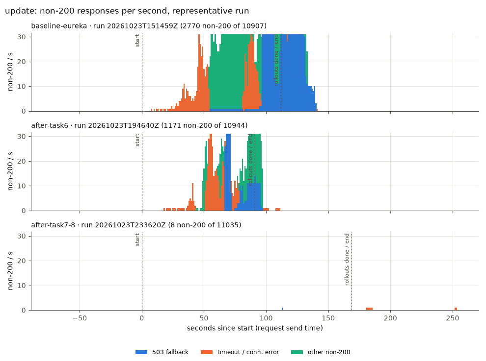 | 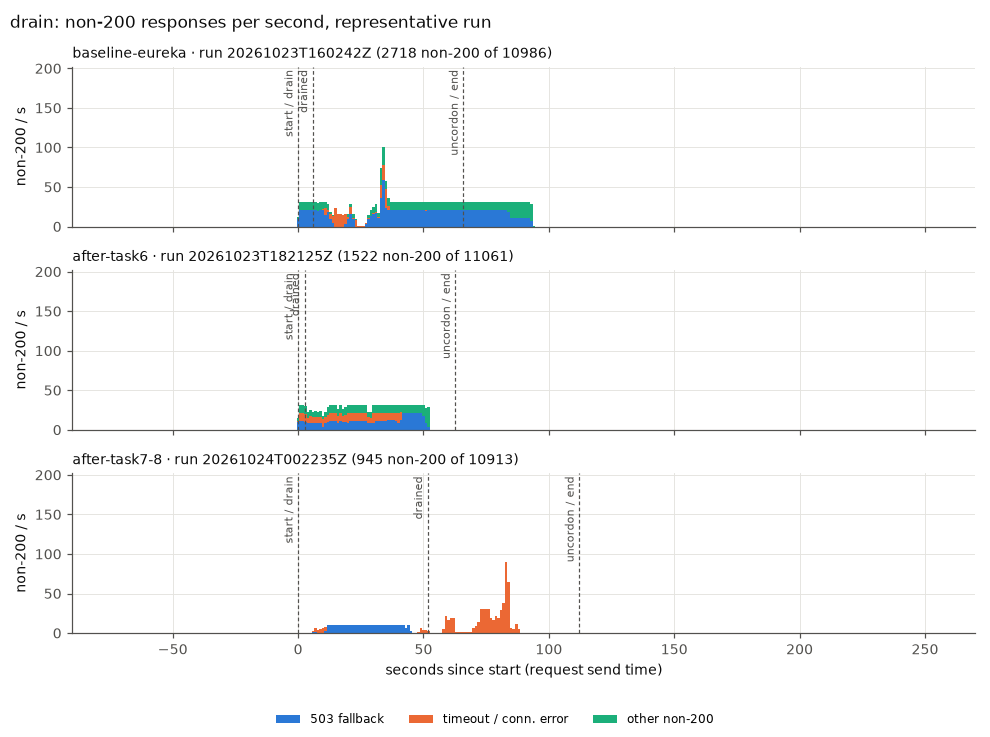 |
| 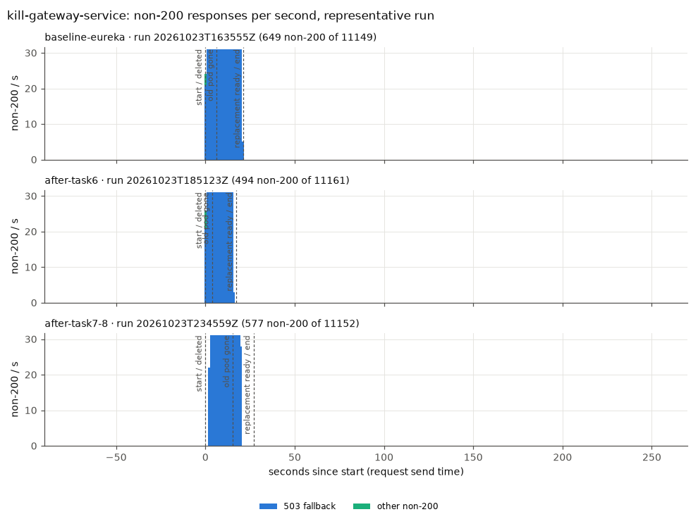 | 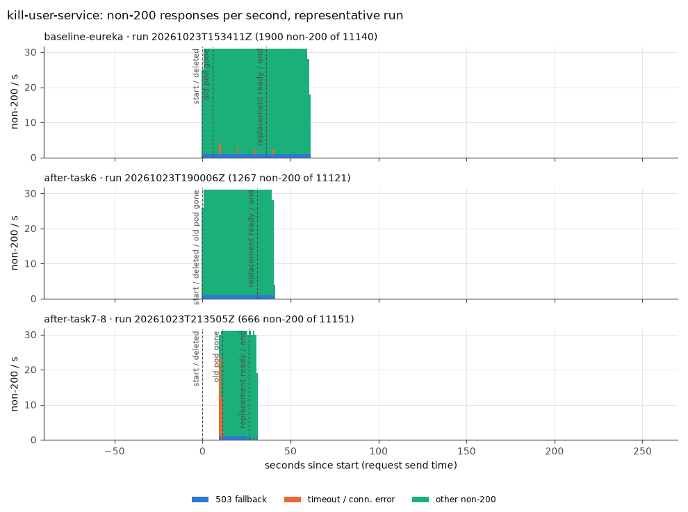 |
| 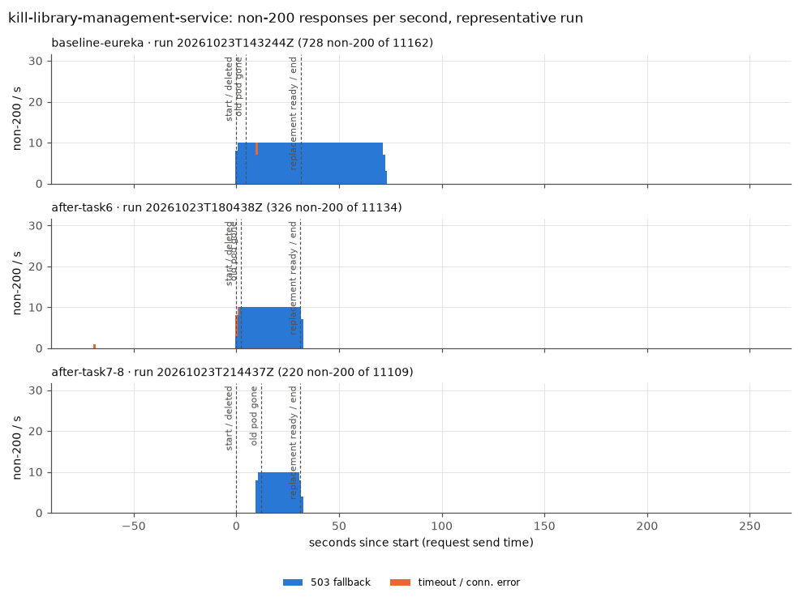 | 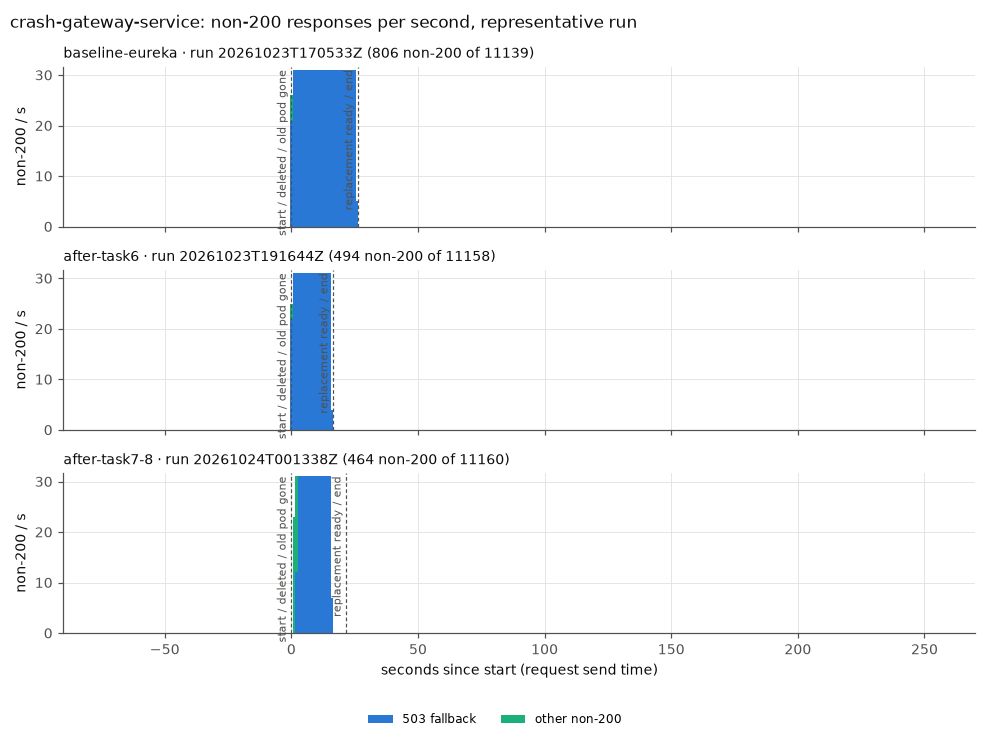 |
| 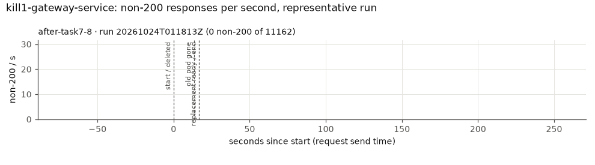 | 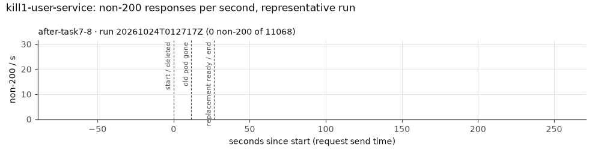 |
| 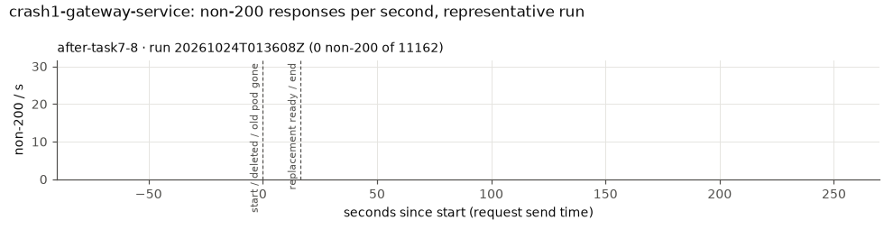 | 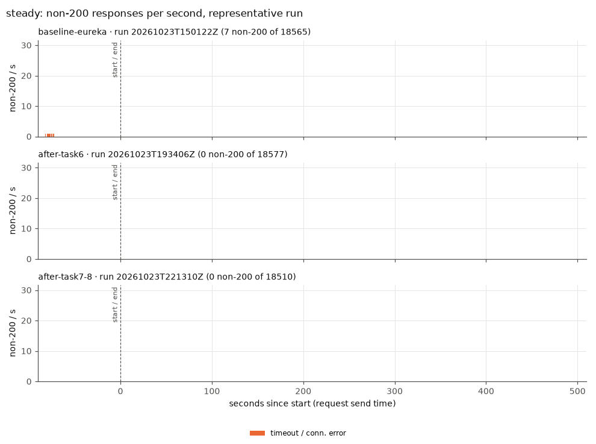 |

## Memory and the replica choice (task 7)

### Measured memory (after task 6, before the change)

Container working set from `kubectl top` (metrics-server, about 15 s resolution), in MiB. *Idle* is the 30 s before k6 starts. *Load* is from 60 s after k6 starts until the end of the `steady` runs. *Peak* is the highest value in any of the 21 runs, including JVM start-up during `update` and `drain`.

| service | idle median | load median | load p95 | load max | peak, any run |
|---|---|---|---|---|---|
| gateway-service | 150 | 181 | 186 | 192 | 226 |
| user-service | 209 | 249 | 258 | 268 | 326 |
| library-management-service | 214 | 251 | 257 | 266 | 291 |
| loan-management-service | 215 | 251 | 258 | 265 | 294 |
| seat-management-service | 211 | 245 | 252 | 256 | 282 |
| ui-service | 140 | 144 | 147 | 153 | 153 |
| postgres | 92 | 100 | 101 | 102 | 166 |
| **sum, one pod each** | 1231 | 1421 | | | **1738** |

The baseline's numbers are similar: the JVMs use 25–36 MiB more each with the Eureka client, and `eureka-server` takes another ~189 MiB.

### Budget

- **Usable per agent.** Allocatable is 15,476 MiB. Without the app, an agent uses 540–630 MiB (kubelet, containerd, k3s agent, svclb, and Traefik on `kube02`): node total from `kubectl top nodes` minus the sum of the app pods on it, in the `steady` runs. Usable is therefore about **14,800 MiB per agent**, or 29,600 MiB for both.
- **Per-pod size.** The peak over all runs (last column above), so start-up spikes are covered.

Check with gateway-service and user-service at two replicas:

| check | requirement | needed | available | result |
|---|---|---|---|---|
| steady state | all pods fit on both agents | 1738 + 226 + 326 = **2290 MiB** | 29,600 MiB | pass (8 %) |
| rollout surge | plus one extra pod per Deployment at the same moment (maxSurge 1) | 2290 + 226 + 326 + 291 + 294 + 282 + 153 = **3862 MiB**, worst case all on one agent | 14,800 MiB | pass (26 %) |
| drain | everything on one agent | **2290 MiB**, or **5632 MiB** if every pod grew to its limit (8 × 640 + 512) | 14,800 MiB | pass (15 %, 38 % at limits) |

Memory doesn't constrain the choice on these nodes. Even two replicas of every service would pass all three checks: 3310 MiB, or 8192 MiB at the limits, on one agent. So the choice follows criticality, as planned:

- **gateway-service and user-service.** Every authenticated read crosses the gateway twice (Traefik → gateway → service, then the service's `JwtFilter` → gateway → user-service) and user-service once. Losing either takes down every endpoint. The single-replica measurements confirm this: killing user-service cost the most failures of any single-pod kill (1162 against 325 for library in `after-task6`), and the failures hit every endpoint, not just one route.
- **library, loan, seat and ui stay at one replica.** Each one's failure only affects its own route (a third of the reads). Keeping them single also shows, within one version, what a replica buys. Memory would allow replicating them, and that would be the next step if their outages matter.
- **CPU is the tighter limit.** At 30 req/s, user-service uses ~370m and the gateway ~140m (median under load). An `update` starts 6–8 JVMs at once on 4 vCPU, and both agents sat at about 2000m during every `update` run. More replicas mean more JVMs competing at start-up. That cost shows up in `update` and in the [placement effect](#placement-and-steady-state-latency), not in memory.

### Requests and limits

Memory requests were set to about the p95 working set under load: gateway **192Mi** (was 256Mi), ui **160Mi** (was 256Mi), and the four data services stay at **256Mi**, close to their p95 of 252–258 MiB. The scheduler's view now matches what the pods use. Limits stay at **640Mi**. That is about twice the highest peak (326 MiB) and leaves room for the heap: `MaxRAMPercentage=75` allows 480 MiB, and the gateway's heap grew to ~480 MiB at 300 req/s during calibration. Postgres keeps its 256Mi request / 512Mi limit: its 100 MiB working set reflects a tiny data set, and its cache would grow with real data.

### After the change

| service | pods | load median per pod | load max per pod | peak, any run |
|---|---|---|---|---|
| gateway-service | 2 | 178 | 210 | 210 |
| user-service | 2 | 244 | 254 | 267 |
| others | 1 each | 143–258 | 148–277 | 150–282 |

The extra replicas cost **~422 MiB** in steady state (178 + 244), or 477 MiB at peak: about 1.5 % of the cluster's usable memory. The working set per pod barely changes with half the load, because it is mostly heap and metaspace sized at start-up, not per-request state. The sum of app pods under load went from ~1.43 GiB to ~1.88 GiB.

## Analysis

### Baseline (Eureka): stale registry entries keep failing requests after the pod is back

*Hypothesis: after a pod kill, the gateway keeps routing to stale registry entries, and the circuit breaker opens and serves 503 for at least `waitDurationInOpenState` = 10 s, even after the pod is ready again.*

**Confirmed, and the effect is larger than 10 s.** After `kill library-management-service`, the replacement was ready after 31 s, but failures continued for another **41 s** (36.8–43.6), almost all of them 503 fallbacks (707 of 713). After `kill user-service`, they continued **36 s** (25.7–45.6) after the pod was ready. That is the gateway's Eureka client and load-balancer cache still pointing at the dead pod's address (both refresh on roughly 30 s intervals by default), plus the open circuit breaker on top. Two observations rule out a slow pod as the explanation:

- **The gateway itself shows no tail** (0.6 s after ready). Traefik reaches it through a Kubernetes Service, not Eureka, and a restarted gateway fetches a fresh registry.
- **Even `steady` was affected:** in one baseline run, every `/api/lendings` request failed with 503 for exactly 10 s right at the start. The registry still listed loan-service's pod from before the reset, the first calls failed, the breaker opened for one `waitDurationInOpenState`, and then it closed again.

Eureka's own pod adds ~189 MiB, and each Eureka client 25–36 MiB per JVM.

### After task 6: Service routing removes the stale entries, not the single-replica outage

*Hypothesis: the Service-based routing removes the stale-registry errors but not the single-replica outage.*

**Confirmed.** Errors after ready dropped to **5.0 s** for library and **8.7 s** for user-service, both under one `waitDurationInOpenState`. The remaining tail is the circuit breaker: it opened during the outage and stays open for up to 10 s after the pod is back. The outage itself remains: the window is the time until the new pod is ready (16–30 s) plus that tail. Failures fell by 54 % (library), 45 % (user-service) and 22 % (gateway). The gateway also starts faster without the Eureka client: ready after 17.9 s instead of 23.1 s. `update` improved from 2861 to 896 failures, because the services' new addresses take effect as soon as the Endpoints change instead of after the next registry refresh.

### After tasks 7 + 8: what replicas and graceful shutdown changed

*Hypothesis: a second gateway/user-service pod keeps the circuit breaker closed; graceful shutdown + preStop bring errors in `kill` and `update` close to zero; `crash` still shows what graceful shutdown cannot fix.*

**Confirmed for single-pod failures of the replicated services: zero failed requests in 9 runs, and the circuit breaker never opened. The data disagrees in three places.**

1. **The matrix's `kill` deletes every pod of the service.** `kubectl delete pod -l app=<service>`, as specified, also removes both replicas of a replicated service. So `kill gateway-service` (543 failures, as before) and `crash gateway-service` (517) after 7+8 measure a *full* outage of a replicated service. They say nothing about what the second replica buys. The extra cells `kill1`/`crash1` delete one pod and answer that question:

   | single pod deleted | runs | non-200 | errors after ready | old pod gone | new pod ready | warm p95 / p99 |
   |---|---|---|---|---|---|---|
   | `kill1 gateway-service` | 3 | **0** in every run | – | 13.2–13.9 s | 16.5–21.7 s | 31–54 / 63–176 ms |
   | `kill1 user-service` | 3 | **0** in every run | – | 11.4–11.6 s | 26.4–26.5 s | 32–56 / 62–367 ms |
   | `crash1 gateway-service` | 3 | **0** in every run | – | 0.5–0.6 s | 16.4–22.1 s | 32–40 / 56–85 ms |
   | *single replica, same disruption (`kill`, after task 6)* | 3 | 545 (gateway), 1162 (user) | 0.7 s, 8.7 s | | | |

   **With a second replica, deleting a pod of the gateway or of user-service costs nothing measurable,** against 545 and 1162 failed requests per kill with one replica. The circuit breaker never opened: no 503 at all. The surviving replica carried the full load while the replacement started, and p99 stayed below 0.4 s. The sequence works as intended: the deleted pod leaves the EndpointSlice at once, but it keeps serving for the 10 s preStop (*old pod gone* at 11–14 s), so whatever still holds a connection to it gets an answer.

   **`crash1` also showed no errors, but it is a weaker test than its name suggests.** `kubectl delete --grace-period=0 --force` removes the Pod object immediately (*old pod gone* 0.5 s), and the endpoint goes with it. The kubelet still stops the container, with a short grace period. At 30 req/s and ~20 ms per request, fewer than one request is in flight on a pod at any moment, so a hard stop has little to lose. A real process crash (OOM kill, `kill -9` of the JVM) would drop those requests and could reset pooled connections. A crash of the only replica (`crash gateway-service`: 495 and 517 failures) shows the other half: no shutdown sequence can help when nothing else serves.

2. **preStop helps even when every pod goes, but only behind kube-proxy.** With all pods of a service terminating, the first error comes **exactly 10.0 s** after the delete for user-service and library; after task 6 it came at 0.0 s. Without a ready endpoint, kube-proxy keeps using *serving* terminating endpoints, so the old pods answer through their whole preStop sleep. That is most of the drop in `kill user-service` from 1162 to 775 failures (10 s × ~31 req/s ≈ 310), and library's drop from 325 to 255. Traefik doesn't do this for the gateway: it drops terminating endpoints at once, and the first 503 came after 2.3 s.

3. **`update` is not close to zero in every run.** Two of the three runs had **1 and 8** failures, all logins timing out while the JVMs started. The third had 733. In that run, the timeouts began the moment the first new user-service pod became ready and took half the traffic. Cold, on agents whose CPUs were both saturated by 6–8 JVMs starting at once, it answered the hairpinned user lookups in more than 10 s (t = 25–64 s). Then Traefik returned 171 × 502 for 14 s, starting when the first old gateway pod went into Terminating while its replacement was seconds old. Routing errors are gone: 503s fell from 325 to 0.7 per run, and the other non-200 (403 and 502) from 278 to 57. What remains is **new pods taking traffic before they are warm, under CPU starvation**. The rollout itself takes longer (127 s against 80 s), because there are two more pods to replace one after the other.

Everywhere else, the shutdown sequence works as designed. On a single-pod delete, the old pod keeps serving for the 10 s preStop, Spring's graceful shutdown then finishes in milliseconds (no request takes long), and the pod is gone after 11–14 s. `crash` skips this sequence: the Pod object disappears at once, and with a single replica the first failure comes at 0–1 s. With two replicas, `crash1` cost nothing, for the reasons given in point 1.

### Drain

*Hypothesis: with PDBs and per-service spread, draining a non-Postgres agent causes no or minimal errors for replicated services; single-replica services still have a gap.*

**Confirmed for the replicated services. The total is dominated by the single-replica ones.** The PDBs work: `kubectl drain` was refused (*"Cannot evict pod as it would violate the pod's disruption budget"*) until each replacement gateway or user-service pod was ready. That is why the drain takes ~115 s instead of ~63 s. The failures per run (812–1897, mean 1218, against 1520 after task 6 and 2747 in the baseline) fall on the endpoints whose **single** pod was on the drained node. In the run with loan and seat on `kube03`, `/api/lendings` and `/api/seats` lost 732 and 744 requests. In the runs with library there, `/api/books/booksAll` lost 429–546. Login, which needs only gateway and user-service, lost 15–42 requests per drain, against 43–52 after task 6. Those are the requests in flight when an evicted replica stopped, plus logins slowed down while the remaining replicas carried all the load and the evicted pods restarted on the other agent. **The kind of failure changed, though.** Timeouts rose from 136 to 675 per run, and the warm p95 of the drain runs went from 0.7 s to 7.1 s. Every evicted JVM restarts on the one remaining agent, next to Postgres and Traefik, while that agent's replicas carry the whole load, and the PDB-paced drain keeps this up for twice as long. Replicating library, loan and seat as well would remove the single-replica gaps. Memory allows it (see above). The real limit is the CPU of one agent during the restarts, so their CPU requests should then reflect start-up use and let the scheduler see that pressure.

### Keep-alive connections to terminating pods

The gateway already recycles its pooled connections (`max-idle-time 30s`, `max-life-time 60s`, added with the Eureka removal), so no connection stays pinned to a replaced pod for long. With preStop, a terminating pod accepts connections for 10 s after it leaves the Endpoints. After that, Tomcat's graceful shutdown closes idle keep-alive connections. A pooled connection the gateway picks in that moment fails with a premature close and becomes a 503 fallback.

**No residual 503s appeared in any single-pod run** (`kill1`: 0 failures in 6 runs). At this rate the race window is too small to show up. It grows with the request rate and with long requests: in-flight requests on the terminating pod finish within Spring's 20 s graceful phase, but a request that picks an idle pooled connection just as Tomcat closes it does not.

Proposed, not implemented: a `Retry` filter on the gateway routes for idempotent `GET`s on `IOException` (connection refused, reset, or closed prematurely), one or two retries with a short backoff, placed inside the circuit breaker. It would turn these into a successful second attempt on the other replica. It must not apply to `POST` (logins, book creation).

### Placement and steady-state latency

The spread constraint as measured (`matchLabelKeys: [app]`, without `pod-template-hash`) did not keep the replicas apart reliably. After `reset.sh`'s rolling restart, the old pods still counted, and **in 9 of 18 runs both replicas of gateway or user-service started on the same agent**. In two of the three `steady` runs, every app pod was on `kube03`. Those two runs had a warm p95 of **656 and 1574 ms**: stalls of about 10 s every 2–3 minutes, with every request at 2–7 s and no errors. The run with the replicas split had **26 ms**, the best of any version. after-task6 also had every pod on `kube03` in two runs, with 7 JVMs instead of 9, and saw no such stalls (46–60 ms). metrics-server's 15 s samples show `kube03` at ~950m of 2000m on average, too coarse to see the bursts; the cause was not isolated. Simultaneous GC or JIT work in nine JVMs on two vCPU, or log rotation under DEBUG logging, would fit. This also inflates the whole-run p95/p99 of `steady` and the kill cells after 7+8.

Fix (pushed after the measurements, `7970a6b`): `matchLabelKeys: [app, pod-template-hash]`, so only pods of the same ReplicaSet count, which is what the Kubernetes documentation recommends for rolling updates.

**Verified after deploying it** (`sha-9fde5a0`, same application code). After each of 5 consecutive `reset.sh` restarts of every Deployment, both gateway-service and user-service had one replica on each agent (5 of 5, against 9 of 18 with the old constraint). One supplementary 10-minute `steady` run under the same conditions (`results/spread-check/`) had 0 failures, a warm p95 of **26.5 ms** and p99 of **46 ms**, and no stall: every 30 s window had a p95 between 20 and 41 ms. That is one run, not a series. It is consistent with the stalls coming from the co-location, not from the replicas, graceful shutdown or probes, but it doesn't prove it. The `after-task7-8` series above was measured before this fix.

### Probes

- **Timeouts.** `timeoutSeconds` went from the default 1 s to 3 s on all probes. The 1 s liveness timeout caused real restarts: user-service twice at 100 req/s from a cold start, loan and seat at 300–400 req/s. At RATE 30, the only restarts were two in the baseline `update` runs; there were none in the other versions.
- **Readiness and liveness groups.** Readiness of the four data services now includes the database (`readinessState,db`), so a pod that loses PostgreSQL leaves the Service. Liveness stays `livenessState` only, so a database outage doesn't restart every pod. Both groups are pinned by tests.
- **Startup budget.** The startup probe allows 5 s × 40 = 200 s. Replacement pods were ready after 16–36 s when one service restarted. In `update`, with every JVM starting at once, one Deployment's rollout took up to 169 s, but that covers two pods one after the other, so each pod stayed well within its 200 s. The budget holds, with less margin under a full rollout than the single-pod numbers suggest.

## Incidents during the work

- **The topology-spread patch broke a deploy.** The first push of task 7 (`ba7675c`) used two constraints, one for the whole stack and one per service with `matchLabelKeys: [app]`. The API server accepts that in a Deployment template but rejects every **Pod** created from it. Only one constraint is allowed per (`topologyKey`, `whenUnsatisfiable`) pair, and `app` may not be in both `matchLabelKeys` and `labelSelector`. The server-side dry-run of the rendered manifests passed, because it doesn't create Pods. The StatefulSet rolled, `postgres-0` could not be recreated, and the database was down for about 20 minutes. `deploy.sh`'s automatic rollback failed as well: the 3-way merge of a list whose two entries share a merge key produced an entry with `maxSkew: 0`.
  - *Recovery:* the StatefulSet's constraint was restored by hand, and the workloads' last-applied annotations were replaced with a valid config. `deploy.sh dd8c8e5` then restored the last good version, and the PDBs it doesn't prune were deleted. The PVC and data were unaffected (27 books / 8 lendings / 32 seats before and after).
  - *Fix:* `6cf0d97`, a single per-service constraint, validated by server-side dry-runs of **Pods** built from every template.
- **RATE 100 was too high from a cold start.** That series was stopped after two runs (see [Choosing RATE](#choosing-rate)).
- **`kill1`/`crash1` first deleted nothing** (`pod/<name>` passed to `kubectl delete pod`). Those runs were discarded, and the script now fails a run whose delete fails.

## Limitations

- **Postgres is a single point of failure.** It is one pod on a local-path volume bound to `kube02`. Draining `kube02` would leave it `Pending` until uncordon, and every service would fail. The `drain` scenario always drains the other agent, so that case was not measured. Readiness now includes the database, so in that case the data services would leave their Services: fallbacks instead of 500s, but an outage all the same.
- **Read-only load.** Writes (lendings, reservations, book creation) were not exercised. A `Retry` filter would have to exclude them, and graceful shutdown matters more for them, because a lost write is worse than a lost read.
- **One load machine,** shared with the control plane: `kube01` has 2 vCPU. Calibration reached 365 req/s from it, so at 30 req/s it was not the bottleneck. Traffic enters on `kube01` and is forwarded by ServiceLB to Traefik on `kube02`, so `kube02` carries the ingress in every run.
- **metrics-server resolution** is 10–15 s. Memory peaks shorter than that, CPU bursts, and the stalls above are not visible in the metrics.
- **DEBUG logging** in the gateway and SQL logging in user-service were left on in every version, to keep the versions comparable. They cost CPU on every request and probably lower the throughput the cluster could otherwise sustain.
- **Only 3 runs per cell.** Several cells vary a lot between runs (`update` after 7+8: 1–733 failures), mostly because of where the scheduler happened to place pods. The means are indicative, and the min–max ranges should be read with them.
- **Placement differs between runs and versions,** because `reset.sh` restarts every Deployment at once and the spread is only preferred (`ScheduleAnyway`). It is recorded for every run (`pods-before.txt`, and the drain table in each `summary.md`).
- **Version differences beyond the topic.** The comparison between versions includes everything that changed between the commits. Between `442f087` and `dd8c8e5`, that is only the Eureka removal and its cleanup.
