# Dostupnost pri poremećajima: Eureka → Kubernetes Services → replike i kontrolisano gašenje

Ovaj izveštaj obuhvata zadatke 5, 7, 8 i 9: merenje početnog stanja, izbor broja replika na osnovu izmerene memorije, uvođenje kontrolisanog gašenja (graceful shutdown) i pregled proba, a zatim ponovno merenje. Skripte su opisane u [README.md](README.md). Generisani rezimei po verzijama nalaze se u `results/<label>/summary.md`, a tabele poređenja verzija u [results/comparison.md](results/comparison.md). Ovo je prevod izveštaja [REPORT.md](REPORT.md); grafikoni su generisani sa `analyze.py --lang sr`.

## Rezime

Tri verzije aplikacije izmerene su pod istim opterećenjem (30 čitanja/s + 1 prijava/s, sa `kube01`) i uz iste poremećaje: ažuriranje (rollout) svih Deployment-a kao u CI-ju, brisanje podova (kontrolisano i prinudno) i pražnjenje (drain) jednog agenta. Svaka ćelija ima 3 ponavljanja.

| poremećaj | početno stanje (Eureka) | posle zadatka 6 (Services) | posle zadataka 7+8 |
|---|---|---|---|
| ažuriranje svih Deployment-a (`update`) | 2861 neuspelih zahteva, najduži prozor grešaka 119 s | 896, 48 s | **247 (1–733), 18 s** |
| obrisan jedan pod **gateway**-a (`kill1`) | 699, 24 s\* | 545, 19 s\* | **0** |
| obrisan jedan pod **user-service**-a (`kill1`) | 2098, 69 s\* | 1162, 38 s\* | **0** |
| prinudno obrisan jedan pod gateway-a (`crash1`) | 754, 25 s\* | 495, 17 s\* | **0** |
| obrisani svi podovi user-service-a (`kill`) | 2098, 69 s | 1162, 38 s | 775, 26 s |
| obrisan library sa jednom replikom (`kill`) | 713, 72 s | 325, 33 s | 255, 27 s |
| pražnjenje agenta bez Postgres-a | 2747, 95 s | 1520, 54 s | 1218, 50 s |
| bez poremećaja, 10 min (`steady`) | 36 | 1 | 2 |

\* jedna replika: brisanje jednog poda je brisanje svih.

- **Uklanjanje Eureka-e (zadatak 6)** uklonilo je greške zbog zastarelog registra. U početnom stanju greške su trajale još 36–41 s pošto je zamenski pod postao spreman; posle zadatka 6 najviše jedan prozor circuit breaker-a (≤ 10 s).
- **Dve replike gateway-a i user-service-a, uz preStop i kontrolisano gašenje (zadaci 7+8),** učinile su da otkaz jednog poda bilo kog od njih klijenti uopšte ne primete: 0 neuspelih zahteva u 9 ponavljanja, a circuit breaker se nijednom nije otvorio. preStop takođe drži stare podove u radu još 10 s kada svi podovi jednog servisa nestanu odjednom, ali samo iza kube-proxy-ja, ne iza Traefik-a.
- **Šta je preostalo:** servisi sa jednom replikom i dalje imaju prekid od ~25–35 s kada njihov pod nestane. `update` i dalje može da ima greške kada novi, „hladni” podovi preuzmu saobraćaj na agentima čiji je CPU zasićen (1 od 3 ponavljanja). Ograničenje raspoređivanja (topology spread) u prvobitnom obliku smestilo je obe replike na isti agent u polovini ponavljanja, što je pogoršalo latenciju u stabilnom stanju (ispravljeno u `7970a6b`, [provereno](#raspored-podova-i-latencija-u-stabilnom-stanju)). Postgres je jedinstvena tačka otkaza.
- **Memorija** nije ograničila izbor: dve replike gateway-a i user-service-a koštaju ~420 MiB, a po agentu je raspoloživo ~14,8 GiB.

## Postavka

| | |
|---|---|
| Klaster | k3s v1.36.5+k3s1 na Ubuntu 26.04.1 (kernel 7.0.0-38). `kube01`: samo server, sa taint-om `CriticalAddonsOnly=true:NoExecute`. `kube02`, `kube03`: agenti. |
| Veličina čvora | po 2 vCPU (Xeon Gold 6240) i 15,1 GiB memorije koja se može dodeliti (allocatable). Ne 4 GiB, kako navode starije beleške. |
| Ingress | Traefik (jedan pod, na `kube02`, istom čvoru kao `postgres-0`) iza ServiceLB-a na portu 8080 svakog čvora. Celo opterećenje ulazi na `http://10.100.50.11:8080`. |
| Baza podataka | Jedan PostgreSQL 17 pod, `postgres-0`, na local-path volumenu vezanom za `kube02`. |
| Mašina za opterećenje | `kube01`, k6 v2.3.0. Deli 2 vCPU sa k3s serverom i jednim ServiceLB podom. Razvojna mašina (2 vCPU, 2 GB, povezana sa klasterom preko VPN-a koji je dva puta pukao tokom rada) nije bila upotrebljiva za generisanje opterećenja. Satovi su sinhronizovani preko NTP-a, a sve vremenske oznake potiču sa `kube01`. |
| Opterećenje | `RATE` = **30 čitanja/s** (naizmenično `GET /api/books/booksAll`, `/api/lendings`, `/api/seats`) + 1 prijava/s, konstantna stopa dolazaka, istek vremena 10 s, uspehom se smatra samo HTTP 200. |
| Ponavljanja | 7 ćelija × 3 ponavljanja po verziji, plus 3 ćelije sa jednim podom × 3 ponavljanja za `after-task7-8`, uz `experiments/reset.sh` pre svakog. Jedno ponavljanje je 30 s mirovanja, zatim k6 tokom 6 min (10 min za `steady`): 90 s zagrevanja, poremećaj i ostatak. Ponavljanja su izvođena naizmenično, po krugovima. |
| Logovanje | Nepromenjeno u svim verzijama: gateway `DEBUG` za `org.springframework.cloud.gateway` i `org.springframework.web`, user-service `show-sql: true`. Svaki zahtev upisuje nekoliko redova u log, i taj trošak je sadržan u svim brojevima u nastavku. |

| Oznaka | Commit | Image-i | Šta je to |
|---|---|---|---|
| `baseline-eureka` | `442f087` | `sha-442f087` | Poslednji commit pre uklanjanja Eureka-e: gateway rutira `lb://<service>` preko Eureka registra, plus pod `eureka-server`. |
| `after-task6` | `dd8c8e5` | `sha-dd8c8e5` | Eureka uklonjena. Gateway rutira na imena Kubernetes Service-a. Preostali `eureka-server` Deployment i Service obrisani su ručno (`kubectl apply` ne briše suvišne objekte). |
| `after-task7-8` | `6cf0d97` | `sha-6cf0d97` | Dve replike gateway-a i user-service-a, PDB-ovi, raspoređivanje po servisu, zahtevi za memoriju (zadatak 7), kontrolisano gašenje, preStop i istek vremena proba (zadatak 8). `6cf0d97` je `ba7675c` plus ispravka njegovog topology spread-a (videti [Incidente](#incidenti-tokom-rada)). |

### Izbor RATE

`calibrate.sh` je povećavao opterećenje na „toplim” podovima početnog stanja u koracima od 2 minuta:

| stopa/s | 10 | 20 | 40 | 60 | 100 | 150 | 200 | 250 | 300 | 400 |
|---|---|---|---|---|---|---|---|---|---|---|
| p95 ms | 58 | 33 | 24 | 25 | 20 | 34 | 64 | 604 | 7228 | 10001 |
| uspešnost | 100 % | 100 % | 100 % | 100 % | 100 % | 100 % | 100 % | 100 % | 99,7 % | 31 % |

p95 se lomi na 200/s, pa je prvi izbor bio 100/s. To se pokazalo kao pogrešno: prva serija početnog stanja na 100/s imala je 31 % grešaka u **`steady`** i dva restarta user-service-a. Svako ponavljanje počinje odmah posle reseta, sa hladnim JVM-ovima, i na 100/s je hladni user-service dostigao svoje CPU ograničenje. Njegova liveness proba (istek vremena 1 s) je tada padala i kubelet ga je dva puta restartovao. Ta dva ponavljanja sačuvana su u `results/calibration/rate100-baseline-eureka/`. Provera hladnog starta (`reset.sh`, zatim 5 min pri fiksnoj stopi) dala je:

| hladan start | ne-200 | p95 | restarti |
|---|---|---|---|
| 60/s | 75 (istekla vremena, uglavnom prijave u prvom minutu) | 4,7 s | 0 |
| 40/s | 0 | 246 ms | 0 |

Scenariji `update` i `kill` takođe stavljaju sveže JVM-ove pod opterećenje, pa važi granica hladnog starta. Polovina od 60/s, gde su se pojavile greške, daje **RATE = 30/s**, korišćeno u svakom ponavljanju svake verzije. Kalibracija je dala i prvi argument za zadatak 8: na 300–400/s liveness probe sa podrazumevanim istekom vremena od 1 s restartovale su loan i seat (topli podovi, zasićen CPU).

## Rezultati

Svaka ćelija daje srednju vrednost 3 ponavljanja, sa (min–maks) gde se ponavljanja razlikuju. *Greške posle spremnosti* je vreme tokom kog su ne-200 odgovori trajali pošto je zamenski pod postao spreman. *Oporavak* je vreme od poremećaja do poslednje sekunde sa greškom. Latencije se odnose na zahteve za čitanje poslate posle početka poremećaja, čime je izostavljeno hladno zagrevanje posle `reset.sh` (vrednosti za celo ponavljanje su u `results/comparison.md`). `*` označava verziju sa jednom replikom prikazanu u ćeliji sa jednim podom: sa jednom replikom `kill1` je isto što i `kill`, pa ti redovi ponavljaju `kill`/`crash` ponavljanja.

Klase statusa: **503** je rezervni odgovor (fallback) circuit breaker-a u gateway-u, ili Traefik-ov „no available server” kada nijedan gateway pod nije spreman. **0** je istek vremena (10 s) ili odbijena ili prekinuta konekcija. **Ostali** ne-200 odgovori su skoro svi **403**, plus **502** (Traefik, tokom `update`). 403 dobija čitalac kada user-service nije dostupan: `JwtFilter` servisa koji čita ne može da pronađe korisnika, pa zahtev ne uspeva kao *neautentifikovan* umesto kao *nedostupan*.

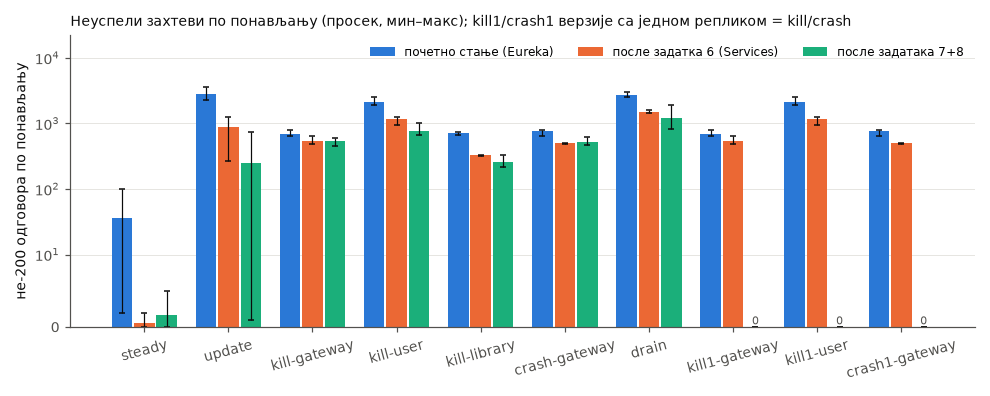

**steady**

| verzija | ponavljanja | ne-200 | ne-200 % | najduži prozor grešaka s | oporavak s | p95 posle početka ms | p99 posle početka ms | restarti |
|---|---|---|---|---|---|---|---|---|
| početno stanje | 3 | 36 (2–100) | 0,20 (0,01–0,54) | 5 (1–10) | 2 (0–7) | 34 (26–40) | 253 (43–444) | 0 |
| zadatak 6 | 3 | 1 (0–2) | 0,00 (0,00–0,01) | 1 (0–2) | 0 | 44 (26–60) | 335 (58–474) | 0 |
| zadaci 7+8 | 3 | 2 (0–5) | 0,01 (0,00–0,03) | 1 (0–3) | 0 | 752 (26–1574) | 2278 (41–3983) | 0 |

**update**

| verzija | ponavljanja | ne-200 | ne-200 % | najduži prozor grešaka s | oporavak s | p95 posle početka ms | p99 posle početka ms | rollout s | restarti |
|---|---|---|---|---|---|---|---|---|---|
| početno stanje | 3 | 2861 (2267–3547) | 26,17 (20,55–32,55) | 119 (91–146) | 146 (126–171) | 8363 (5088–10000) | 9800 (9400–10001) | 102 (82–112) | 1 (0–1) |
| zadatak 6 | 3 | 896 (271–1246) | 8,18 (2,46–11,38) | 48 (11–77) | 97 (62–118) | 6895 (3067–9009) | 8968 (6902–10000) | 80 (61–91) | 0 |
| zadaci 7+8 | 3 | 247 (1–733) | 2,26 (0,01–6,71) | 18 (1–49) | 147 (83–254) | 4400 (1229–9792) | 6659 (4339–10000) | 127 (84–169) | 0 |

**kill-gateway-service**

| verzija | ponavljanja | ne-200 | ne-200 % | najduži prozor grešaka s | oporavak s | greške posle spremnosti s | p95 posle početka ms | p99 posle početka ms | restarti |
|---|---|---|---|---|---|---|---|---|---|
| početno stanje | 3 | 699 (645–804) | 6,27 (5,78–7,22) | 24 (22–27) | 24 (22–27) | 0,6 (0,5–0,7) | 40 (38–43) | 296 (151–553) | 0 |
| zadatak 6 | 3 | 545 (493–649) | 4,89 (4,42–5,83) | 19 (17–22) | 19 (17–22) | 0,7 (0,6–0,8) | 38 (31–48) | 155 (100–247) | 0 |
| zadaci 7+8 | 3 | 543 (446–607) | 4,87 (4,01–5,44) | 18 (15–20) | 20 (17–23) | 0,0 | 55 (35–70) | 605 (253–832) | 0 |

**kill-user-service**

| verzija | ponavljanja | ne-200 | ne-200 % | najduži prozor grešaka s | oporavak s | greške posle spremnosti s | p95 posle početka ms | p99 posle početka ms | restarti |
|---|---|---|---|---|---|---|---|---|---|
| početno stanje | 3 | 2098 (1885–2510) | 18,83 (16,90–22,53) | 69 (62–82) | 69 (62–82) | 35,6 (25,7–45,6) | 46 (33–55) | 89 (71–117) | 0 |
| zadatak 6 | 3 | 1162 (951–1267) | 10,43 (8,52–11,39) | 38 (31–42) | 38 (31–42) | 8,7 (4,6–10,8) | 47 (30–56) | 84 (56–107) | 0 |
| zadaci 7+8 | 3 | 775 (659–1001) | 6,97 (5,92–9,03) | 26 (22–33) | 36 (32–43) | 3,9 (0,0–6,2) | 86 (41–144) | 366 (92–513) | 0 |

**kill-library-management-service**

| verzija | ponavljanja | ne-200 | ne-200 % | najduži prozor grešaka s | oporavak s | greške posle spremnosti s | p95 posle početka ms | p99 posle početka ms | restarti |
|---|---|---|---|---|---|---|---|---|---|
| početno stanje | 3 | 713 (670–741) | 6,39 (6,00–6,64) | 72 (68–75) | 72 (68–75) | 41,0 (36,8–43,6) | 32 (31–32) | 56 (50–62) | 0 |
| zadatak 6 | 3 | 325 (324–326) | 2,92 (2,90–2,93) | 33 (33–34) | 33 | 5,0 (1,8–6,8) | 53 (35–82) | 249 (114–380) | 0 |
| zadaci 7+8 | 3 | 255 (219–326) | 2,29 (1,96–2,92) | 27 (23–34) | 37 (33–44) | 5,1 (1,8–7,7) | 38 (33–46) | 161 (67–345) | 0 |

**crash-gateway-service**

| verzija | ponavljanja | ne-200 | ne-200 % | najduži prozor grešaka s | oporavak s | greške posle spremnosti s | p95 posle početka ms | p99 posle početka ms | restarti |
|---|---|---|---|---|---|---|---|---|---|
| početno stanje | 3 | 754 (649–807) | 6,77 (5,82–7,24) | 25 (22–27) | 25 (22–27) | 0,6 (0,5–0,7) | 42 (33–51) | 512 (261–675) | 0 |
| zadatak 6 | 3 | 495 (493–498) | 4,44 (4,42–4,47) | 17 | 17 | 0,7 (0,6–0,8) | 45 (38–57) | 477 (391–582) | 0 |
| zadaci 7+8 | 3 | 517 (464–622) | 4,64 (4,16–5,59) | 18 (16–21) | 19 (17–22) | 0,0 | 47 (37–58) | 395 (255–663) | 0 |

**drain**

| verzija | ponavljanja | ne-200 | ne-200 % | najduži prozor grešaka s | oporavak s | p95 posle početka ms | p99 posle početka ms | restarti |
|---|---|---|---|---|---|---|---|---|
| početno stanje | 3 | 2747 (2551–2972) | 24,93 (23,35–26,70) | 95 (93–98) | 95 (93–98) | 4450 (360–10000) | 7270 (1811–10000) | 0 |
| zadatak 6 | 3 | 1520 (1441–1598) | 13,68 (12,95–14,33) | 54 (53–57) | 54 (52–57) | 695 (139–1805) | 4005 (796–10001) | 0 |
| zadaci 7+8 | 3 | 1218 (812–1897) | 11,15 (7,40–17,40) | 50 (40–67) | 91 (67–117) | 7135 (4820–10000) | 10000 (10000–10001) | 0 |

**kill1-gateway-service**

| verzija | ponavljanja | ne-200 | ne-200 % | najduži prozor grešaka s | oporavak s | greške posle spremnosti s | p95 posle početka ms | p99 posle početka ms | restarti |
|---|---|---|---|---|---|---|---|---|---|
| početno stanje\* | 3 | 699 (645–804) | 6,27 (5,78–7,22) | 24 (22–27) | 24 (22–27) | 0,6 (0,5–0,7) | 40 (38–43) | 296 (151–553) | 0 |
| zadatak 6\* | 3 | 545 (493–649) | 4,89 (4,42–5,83) | 19 (17–22) | 19 (17–22) | 0,7 (0,6–0,8) | 38 (31–48) | 155 (100–247) | 0 |
| zadaci 7+8 | 3 | 0 | 0,00 | 0 | 0 | 0,0 | 44 (31–54) | 135 (63–176) | 0 |

**kill1-user-service**

| verzija | ponavljanja | ne-200 | ne-200 % | najduži prozor grešaka s | oporavak s | greške posle spremnosti s | p95 posle početka ms | p99 posle početka ms | restarti |
|---|---|---|---|---|---|---|---|---|---|
| početno stanje\* | 3 | 2098 (1885–2510) | 18,83 (16,90–22,53) | 69 (62–82) | 69 (62–82) | 35,6 (25,7–45,6) | 46 (33–55) | 89 (71–117) | 0 |
| zadatak 6\* | 3 | 1162 (951–1267) | 10,43 (8,52–11,39) | 38 (31–42) | 38 (31–42) | 8,7 (4,6–10,8) | 47 (30–56) | 84 (56–107) | 0 |
| zadaci 7+8 | 3 | 0 | 0,00 | 0 | 0 | 0,0 | 42 (32–56) | 255 (62–366) | 0 |

**crash1-gateway-service**

| verzija | ponavljanja | ne-200 | ne-200 % | najduži prozor grešaka s | oporavak s | greške posle spremnosti s | p95 posle početka ms | p99 posle početka ms | restarti |
|---|---|---|---|---|---|---|---|---|---|
| početno stanje\* | 3 | 754 (649–807) | 6,77 (5,82–7,24) | 25 (22–27) | 25 (22–27) | 0,6 (0,5–0,7) | 42 (33–51) | 512 (261–675) | 0 |
| zadatak 6\* | 3 | 495 (493–498) | 4,44 (4,42–4,47) | 17 | 17 | 0,7 (0,6–0,8) | 45 (38–57) | 477 (391–582) | 0 |
| zadaci 7+8 | 3 | 0 | 0,00 | 0 | 0 | 0,0 | 35 (32–40) | 69 (56–85) | 0 |

Vremenski tokovi za jedno reprezentativno ponavljanje po ćeliji i verziji (ponavljanje sa medijalnim brojem grešaka):

| | |
|---|---|
| 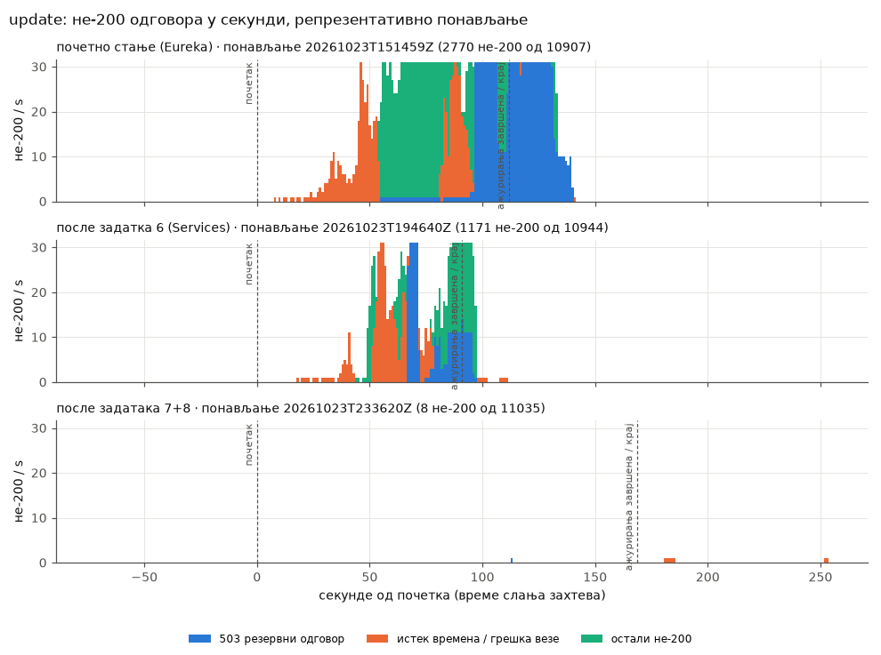 | 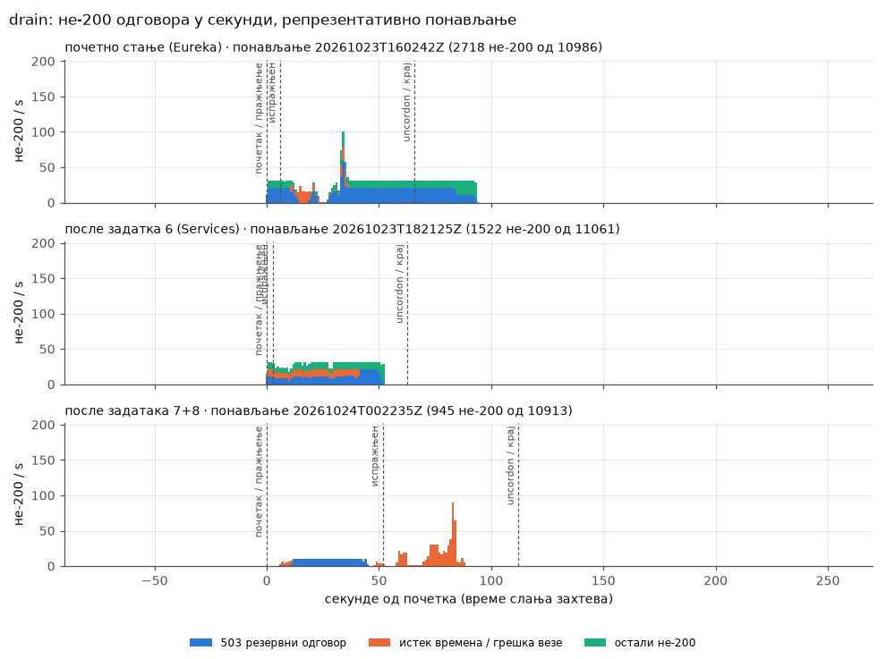 |
| 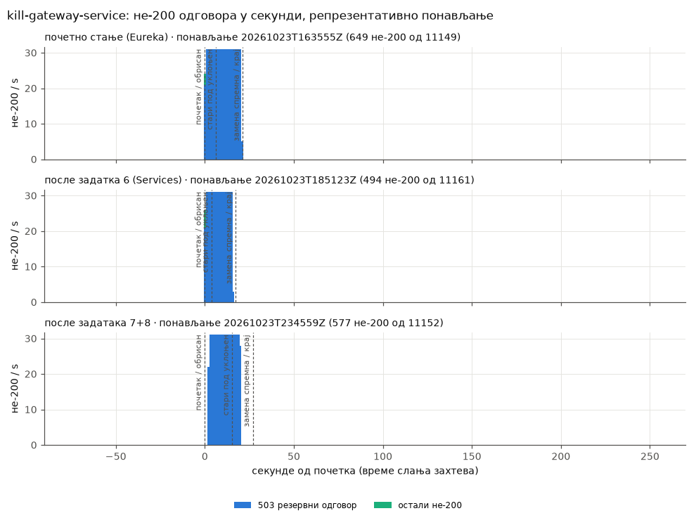 | 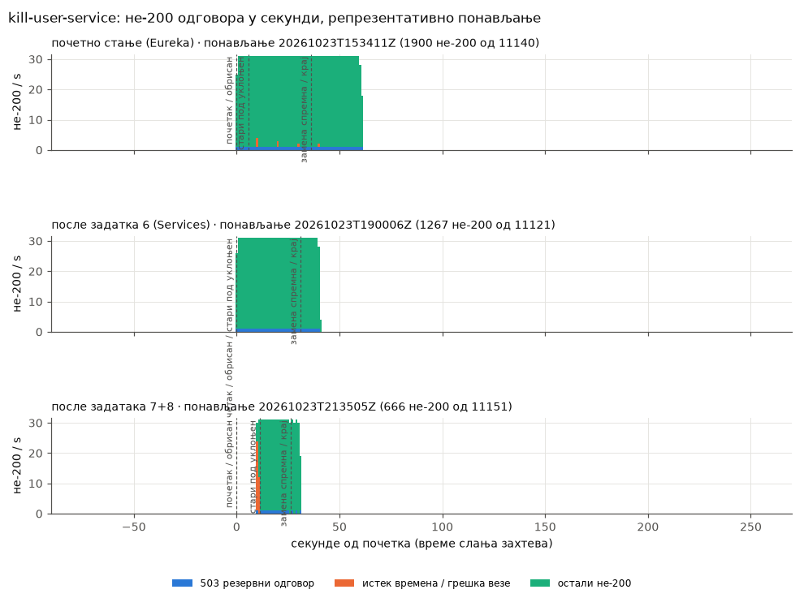 |
| 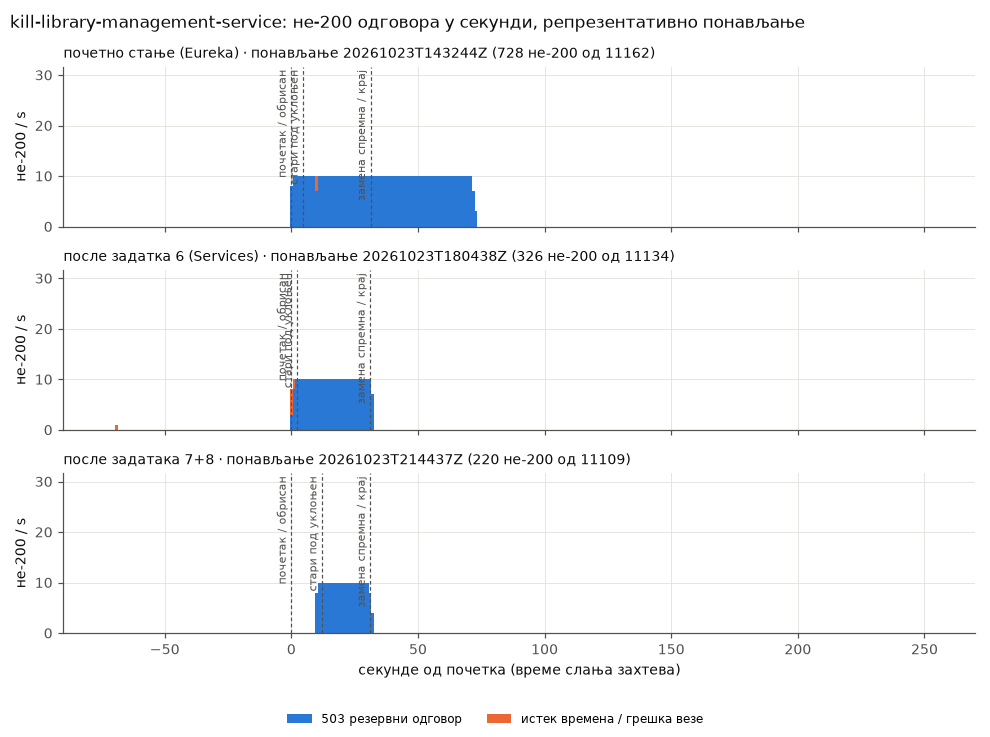 | 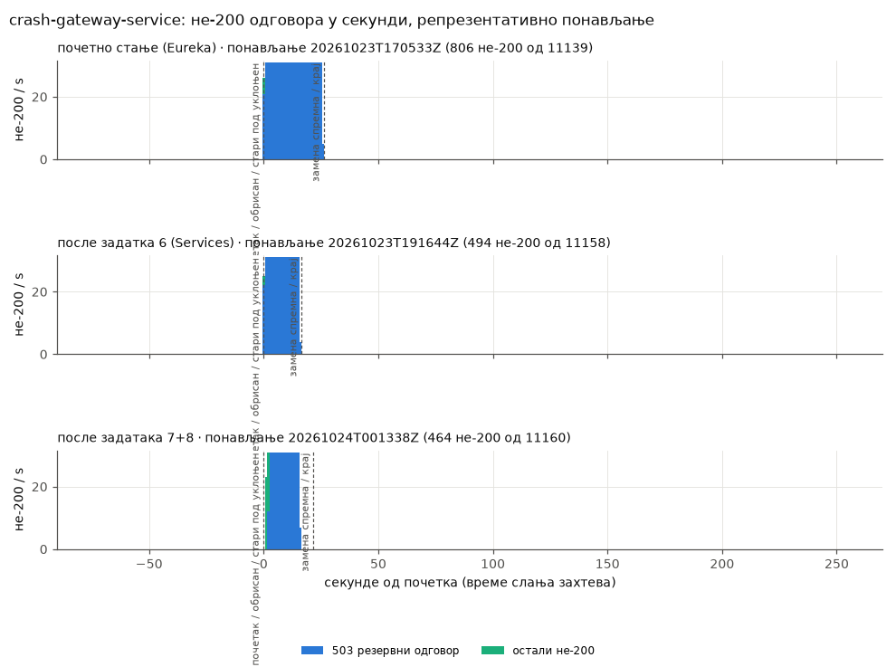 |
| 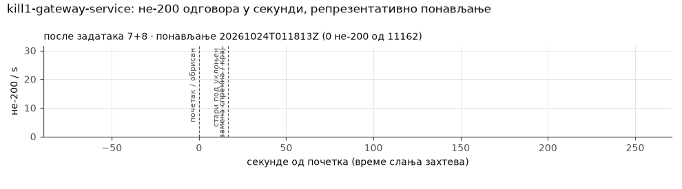 | 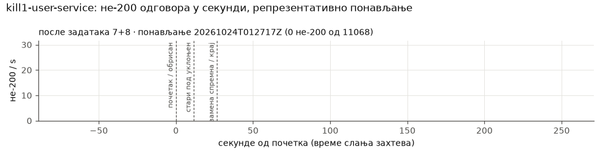 |
| 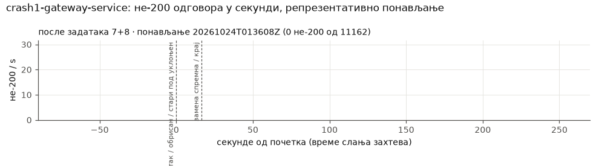 | 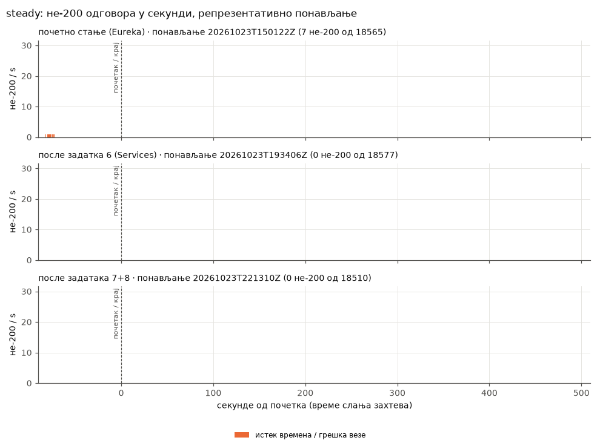 |

## Memorija i izbor broja replika (zadatak 7)

### Izmerena memorija (posle zadatka 6, pre izmene)

Radni skup (working set) kontejnera iz `kubectl top` (metrics-server, rezolucija oko 15 s), u MiB. *Mirovanje* je 30 s pre pokretanja k6. *Opterećenje* je od 60 s posle pokretanja k6 do kraja `steady` ponavljanja. *Vrh* je najveća vrednost u bilo kom od 21 ponavljanja, uključujući pokretanje JVM-a tokom `update` i `drain`.

| servis | mirovanje, medijana | opterećenje, medijana | opterećenje, p95 | opterećenje, maks | vrh, bilo koje ponavljanje |
|---|---|---|---|---|---|
| gateway-service | 150 | 181 | 186 | 192 | 226 |
| user-service | 209 | 249 | 258 | 268 | 326 |
| library-management-service | 214 | 251 | 257 | 266 | 291 |
| loan-management-service | 215 | 251 | 258 | 265 | 294 |
| seat-management-service | 211 | 245 | 252 | 256 | 282 |
| ui-service | 140 | 144 | 147 | 153 | 153 |
| postgres | 92 | 100 | 101 | 102 | 166 |
| **zbir, po jedan pod** | 1231 | 1421 | | | **1738** |

Brojevi početnog stanja su slični: sa Eureka klijentom JVM-ovi koriste po 25–36 MiB više, a `eureka-server` zauzima još ~189 MiB.

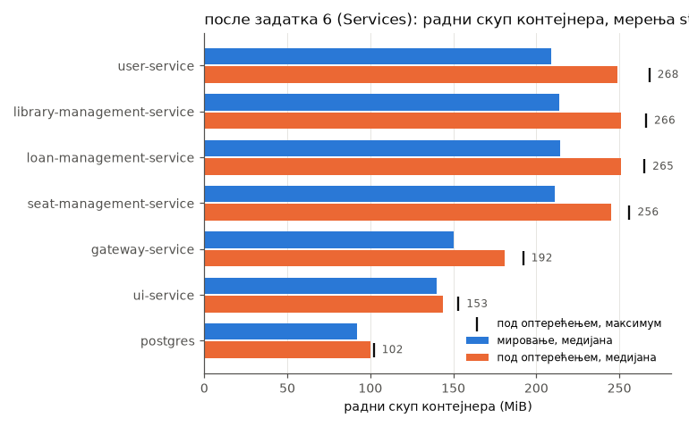

### Budžet

- **Raspoloživo po agentu.** Allocatable je 15 476 MiB. Bez aplikacije agent koristi 540–630 MiB (kubelet, containerd, k3s agent, svclb i Traefik na `kube02`): ukupno za čvor iz `kubectl top nodes` minus zbir podova aplikacije na njemu, u `steady` ponavljanjima. Raspoloživo je dakle oko **14 800 MiB po agentu**, odnosno 29 600 MiB za oba.
- **Veličina po podu.** Vrh preko svih ponavljanja (poslednja kolona iznad), tako da su pokriveni skokovi pri pokretanju.

Provera sa po dve replike gateway-service-a i user-service-a:

| provera | uslov | potrebno | raspoloživo | rezultat |
|---|---|---|---|---|
| stabilno stanje | svi podovi staju na oba agenta | 1738 + 226 + 326 = **2290 MiB** | 29 600 MiB | prolazi (8 %) |
| višak pri ažuriranju | plus po jedan dodatni pod za svaki Deployment u istom trenutku (maxSurge 1) | 2290 + 226 + 326 + 291 + 294 + 282 + 153 = **3862 MiB**, najgori slučaj sve na jednom agentu | 14 800 MiB | prolazi (26 %) |
| pražnjenje | sve na jednom agentu | **2290 MiB**, ili **5632 MiB** ako bi svaki pod narastao do svog ograničenja (8 × 640 + 512) | 14 800 MiB | prolazi (15 %, 38 % pri ograničenjima) |

Na ovim čvorovima memorija ne ograničava izbor. Čak bi i po dve replike svakog servisa prošle sve tri provere: 3310 MiB, ili 8192 MiB pri ograničenjima, na jednom agentu. Zato izbor prati kritičnost, kako je i planirano:

- **gateway-service i user-service.** Svako autentifikovano čitanje dva puta prolazi kroz gateway (Traefik → gateway → servis, a zatim `JwtFilter` servisa → gateway → user-service) i jednom kroz user-service. Gubitak bilo kog od njih obara sve endpoint-e. Merenja sa jednom replikom to potvrđuju: brisanje user-service-a izazvalo je najviše grešaka od svih brisanja jednog poda (1162 naspram 325 za library u `after-task6`), a greške su pogodile sve endpoint-e, ne samo jednu rutu.
- **library, loan, seat i ui ostaju sa jednom replikom.** Otkaz svakog od njih pogađa samo njegovu rutu (trećinu čitanja). Ostavljanje po jedne replike takođe pokazuje, unutar iste verzije, šta replika donosi. Memorija bi dozvolila i njihovo repliciranje, i to bi bio sledeći korak ako su njihovi prekidi bitni.
- **CPU je strože ograničenje.** Pri 30 zahteva/s user-service koristi ~370m, a gateway ~140m (medijana pod opterećenjem). `update` pokreće 6–8 JVM-ova odjednom na 4 vCPU, i oba agenta su bila na oko 2000m tokom svakog `update` ponavljanja. Više replika znači više JVM-ova koji se nadmeću pri pokretanju. Taj trošak se vidi u `update` i u [efektu rasporeda](#raspored-podova-i-latencija-u-stabilnom-stanju), ne u memoriji.

### Zahtevi i ograničenja (requests i limits)

Zahtevi za memoriju postavljeni su na otprilike p95 radnog skupa pod opterećenjem: gateway **192Mi** (bilo je 256Mi), ui **160Mi** (bilo je 256Mi), a četiri servisa za podatke ostaju na **256Mi**, blizu svog p95 od 252–258 MiB. Planer (scheduler) sada vidi ono što podovi zaista koriste. Ograničenja ostaju **640Mi**. To je oko dvostruko više od najvišeg vrha (326 MiB) i ostavlja prostor za heap: `MaxRAMPercentage=75` dozvoljava 480 MiB, a heap gateway-a je tokom kalibracije narastao do ~480 MiB pri 300 zahteva/s. Postgres zadržava zahtev 256Mi / ograničenje 512Mi: njegov radni skup od 100 MiB odražava malu količinu podataka, a njegov keš bi rastao sa stvarnim podacima.

### Posle izmene

| servis | podova | opterećenje, medijana po podu | opterećenje, maks po podu | vrh, bilo koje ponavljanje |
|---|---|---|---|---|
| gateway-service | 2 | 178 | 210 | 210 |
| user-service | 2 | 244 | 254 | 267 |
| ostali | po 1 | 143–258 | 148–277 | 150–282 |

Dodatne replike koštaju **~422 MiB** u stabilnom stanju (178 + 244), odnosno 477 MiB u vrhu: oko 1,5 % raspoložive memorije klastera. Radni skup po podu se jedva menja sa upola manjim opterećenjem, jer ga uglavnom čine heap i metaspace čija se veličina određuje pri pokretanju, a ne stanje po zahtevu. Zbir podova aplikacije pod opterećenjem porastao je sa ~1,43 GiB na ~1,88 GiB.

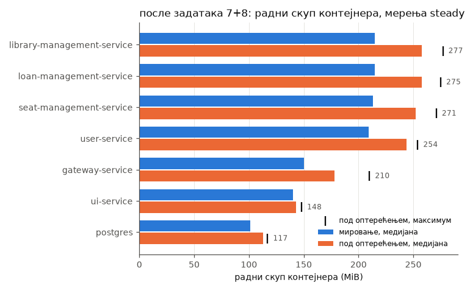

## Analiza

### Početno stanje (Eureka): zastareli unosi u registru i dalje obaraju zahteve kada je pod već ponovo u radu

*Hipoteza: posle brisanja poda gateway i dalje rutira na zastarele unose iz registra, a circuit breaker se otvara i vraća 503 najmanje `waitDurationInOpenState` = 10 s, čak i kada je pod ponovo spreman.*

**Potvrđeno, a efekat je veći od 10 s.** Posle `kill library-management-service` zamena je bila spremna posle 31 s, ali su greške trajale još **41 s** (36,8–43,6), skoro sve kao 503 rezervni odgovori (707 od 713). Posle `kill user-service` trajale su još **36 s** (25,7–45,6) pošto je pod bio spreman. To su Eureka klijent i keš load balancer-a u gateway-u koji i dalje pokazuju na adresu mrtvog poda (oba se podrazumevano osvežavaju u intervalima od oko 30 s), uz otvoren circuit breaker povrh toga. Dva zapažanja isključuju spor pod kao objašnjenje:

- **Sam gateway nema „rep”** (0,6 s posle spremnosti). Traefik do njega stiže preko Kubernetes Service-a, ne preko Eureka-e, a restartovani gateway preuzima svež registar.
- **Čak je i `steady` bio pogođen:** u jednom ponavljanju početnog stanja svaki zahtev na `/api/lendings` vraćao je 503 tačno 10 s odmah na početku. Registar je još uvek sadržao pod loan-service-a od pre reseta, prvi pozivi nisu uspeli, breaker se otvorio na jedan `waitDurationInOpenState`, a zatim se ponovo zatvorio.

Eureka pod dodaje ~189 MiB, a svaki Eureka klijent po 25–36 MiB po JVM-u.

### Posle zadatka 6: rutiranje preko Service-a uklanja zastarele unose, ali ne i prekid kod jedne replike

*Hipoteza: rutiranje preko Service-a uklanja greške zbog zastarelog registra, ali ne i prekid kod servisa sa jednom replikom.*

**Potvrđeno.** Greške posle spremnosti pale su na **5,0 s** za library i **8,7 s** za user-service, obe ispod jednog `waitDurationInOpenState`. Preostali „rep” je circuit breaker: otvorio se tokom prekida i ostaje otvoren do 10 s pošto se pod vrati. Sam prekid ostaje: prozor grešaka je vreme dok novi pod ne postane spreman (16–30 s) plus taj rep. Broj grešaka smanjio se za 54 % (library), 45 % (user-service) i 22 % (gateway). Gateway se bez Eureka klijenta i brže pokreće: spreman je posle 17,9 s umesto 23,1 s. `update` se popravio sa 2861 na 896 grešaka, jer nove adrese servisa važe čim se Endpoints promene, umesto posle sledećeg osvežavanja registra.

### Posle zadataka 7 + 8: šta su promenile replike i kontrolisano gašenje

*Hipoteza: drugi pod gateway-a/user-service-a drži circuit breaker zatvorenim; kontrolisano gašenje + preStop svode greške u `kill` i `update` skoro na nulu; `crash` i dalje pokazuje ono što kontrolisano gašenje ne može da reši.*

**Potvrđeno za otkaze jednog poda repliciranih servisa: nula neuspelih zahteva u 9 ponavljanja, a circuit breaker se nijednom nije otvorio. Podaci se ne slažu sa hipotezom na tri mesta.**

1. **`kill` iz matrice briše sve podove servisa.** `kubectl delete pod -l app=<service>`, kako je propisano, uklanja i obe replike repliciranog servisa. Tako `kill gateway-service` (543 greške, kao i ranije) i `crash gateway-service` (517) posle 7+8 mere *potpuni* prekid repliciranog servisa. Oni ne govore ništa o tome šta donosi druga replika. Na to pitanje odgovaraju dodatne ćelije `kill1`/`crash1`, koje brišu jedan pod:

   | obrisan jedan pod | ponavljanja | ne-200 | greške posle spremnosti | stari pod uklonjen | novi pod spreman | topli p95 / p99 |
   |---|---|---|---|---|---|---|
   | `kill1 gateway-service` | 3 | **0** u svakom ponavljanju | – | 13,2–13,9 s | 16,5–21,7 s | 31–54 / 63–176 ms |
   | `kill1 user-service` | 3 | **0** u svakom ponavljanju | – | 11,4–11,6 s | 26,4–26,5 s | 32–56 / 62–367 ms |
   | `crash1 gateway-service` | 3 | **0** u svakom ponavljanju | – | 0,5–0,6 s | 16,4–22,1 s | 32–40 / 56–85 ms |
   | *jedna replika, isti poremećaj (`kill`, posle zadatka 6)* | 3 | 545 (gateway), 1162 (user) | 0,7 s, 8,7 s | | | |

   **Sa drugom replikom brisanje poda gateway-a ili user-service-a ne košta ništa merljivo,** naspram 545 i 1162 neuspela zahteva po brisanju sa jednom replikom. Circuit breaker se nijednom nije otvorio: nijedan 503. Preostala replika je nosila celo opterećenje dok se zamena pokretala, a p99 je ostao ispod 0,4 s. Redosled radi kako je zamišljeno: obrisani pod odmah izlazi iz EndpointSlice-a, ali nastavlja da odgovara tokom preStop pauze od 10 s (*stari pod uklonjen* posle 11–14 s), tako da sve što još drži konekciju ka njemu dobija odgovor.

   **I `crash1` je bio bez grešaka, ali je to slabiji test nego što mu ime kaže.** `kubectl delete --grace-period=0 --force` odmah uklanja Pod objekat (*stari pod uklonjen* 0,5 s), a sa njim nestaje i endpoint. Kubelet i dalje zaustavlja kontejner, sa kratkim periodom gašenja. Pri 30 zahteva/s i ~20 ms po zahtevu, u svakom trenutku je u toku manje od jednog zahteva po podu, pa naglo zaustavljanje nema mnogo šta da izgubi. Pravi pad procesa (OOM kill, `kill -9` JVM-a) bi odbacio te zahteve i mogao bi da prekine konekcije iz pool-a. Pad jedine replike (`crash gateway-service`: 495 i 517 grešaka) pokazuje drugu stranu: nikakav redosled gašenja ne može da pomogne kada nema ničeg drugog da služi zahteve.

2. **preStop pomaže čak i kada nestanu svi podovi, ali samo iza kube-proxy-ja.** Kada se gase svi podovi servisa, prva greška dolazi **tačno 10,0 s** posle brisanja za user-service i library; posle zadatka 6 dolazila je posle 0,0 s. Bez spremnog endpoint-a kube-proxy nastavlja da koristi endpoint-e koji se gase a još *služe* (serving terminating), pa stari podovi odgovaraju tokom cele preStop pauze. To čini veći deo pada kod `kill user-service` sa 1162 na 775 grešaka (10 s × ~31 zahteva/s ≈ 310), kao i pada kod library sa 325 na 255. Traefik to ne radi za gateway: on odmah odbacuje endpoint-e koji se gase, i prvi 503 je stigao posle 2,3 s.

3. **`update` nije skoro na nuli u svakom ponavljanju.** Dva od tri ponavljanja imala su **1 i 8** grešaka, sve prijave kojima je isteklo vreme dok su se JVM-ovi pokretali. Treće je imalo 733. U tom ponavljanju istekanja vremena počela su u trenutku kada je prvi novi pod user-service-a postao spreman i preuzeo polovinu saobraćaja. Hladan, na agentima čija su oba CPU-a bila zasićena sa 6–8 JVM-ova koji se istovremeno pokreću, odgovarao je na „hairpin” provere korisnika za više od 10 s (t = 25–64 s). Zatim je Traefik vraćao 171 × 502 tokom 14 s, počevši kada je prvi stari gateway pod prešao u Terminating dok je njegova zamena bila stara tek nekoliko sekundi. Greške rutiranja su nestale: broj 503 pao je sa 325 na 0,7 po ponavljanju, a ostalih ne-200 (403 i 502) sa 278 na 57. Ono što ostaje su **novi podovi koji preuzimaju saobraćaj pre nego što su se zagrejali, uz nedostatak CPU-a**. Samo ažuriranje traje duže (127 s naspram 80 s), jer postoje još dva poda koja se zamenjuju jedan za drugim.

Svuda drugde redosled gašenja radi kako je zamišljeno. Pri brisanju jednog poda stari pod nastavlja da služi zahteve tokom preStop pauze od 10 s, Spring-ovo kontrolisano gašenje se zatim završava za nekoliko milisekundi (nijedan zahtev ne traje dugo), i pod nestaje posle 11–14 s. `crash` preskače ovaj redosled: Pod objekat odmah nestaje, i sa jednom replikom prva greška dolazi posle 0–1 s. Sa dve replike `crash1` nije koštao ništa, iz razloga navedenih u tački 1.

### Pražnjenje čvora (drain)

*Hipoteza: sa PDB-ovima i raspoređivanjem po servisu, pražnjenje agenta bez Postgres-a ne izaziva greške ili izaziva minimalne greške kod repliciranih servisa; servisi sa jednom replikom i dalje imaju prekid.*

**Potvrđeno za replicirane servise. Ukupnim brojem dominiraju servisi sa jednom replikom.** PDB-ovi rade: `kubectl drain` je bio odbijen (*„Cannot evict pod as it would violate the pod's disruption budget”*) dok svaki zamenski pod gateway-a ili user-service-a nije postao spreman. Zato pražnjenje traje ~115 s umesto ~63 s. Greške po ponavljanju (812–1897, prosek 1218, naspram 1520 posle zadatka 6 i 2747 u početnom stanju) padaju na endpoint-e čiji se **jedini** pod nalazio na ispražnjenom čvoru. U ponavljanju u kom su loan i seat bili na `kube03`, `/api/lendings` i `/api/seats` izgubili su 732 i 744 zahteva. U ponavljanjima u kojima je tamo bio library, `/api/books/booksAll` je izgubio 429–546. Prijava, kojoj trebaju samo gateway i user-service, izgubila je 15–42 zahteva po pražnjenju, naspram 43–52 posle zadatka 6. To su zahtevi koji su bili u toku kada se izbačena replika zaustavila, plus prijave usporene dok su preostale replike nosile celo opterećenje, a izbačeni podovi se ponovo pokretali na drugom agentu. **Vrsta greške se, međutim, promenila.** Broj isteklih vremena porastao je sa 136 na 675 po ponavljanju, a topli p95 ponavljanja sa pražnjenjem sa 0,7 s na 7,1 s. Svaki izbačeni JVM se ponovo pokreće na jedinom preostalom agentu, pored Postgres-a i Traefik-a, dok replike na tom agentu nose celo opterećenje, a pražnjenje u tempu koji diktiraju PDB-ovi ovo stanje održava dvostruko duže. Repliciranje i library, loan i seat servisa uklonilo bi prekide kod servisa sa jednom replikom. Memorija to dozvoljava (videti iznad). Pravo ograničenje je CPU jednog agenta tokom ponovnih pokretanja, pa bi njihovi CPU zahtevi tada trebalo da odražavaju potrošnju pri pokretanju i da omoguće planeru da vidi taj pritisak.

### Keep-alive konekcije ka podovima koji se gase

Gateway već obnavlja svoje konekcije iz pool-a (`max-idle-time 30s`, `max-life-time 60s`, dodato sa uklanjanjem Eureka-e), tako da nijedna konekcija dugo ne ostaje vezana za zamenjeni pod. Sa preStop-om, pod koji se gasi prihvata konekcije još 10 s pošto izađe iz Endpoints-a. Posle toga Tomcat-ovo kontrolisano gašenje zatvara neaktivne keep-alive konekcije. Konekcija iz pool-a koju gateway izabere baš u tom trenutku pada sa preuranjenim zatvaranjem (premature close) i postaje 503 rezervni odgovor.

**Nijedan zaostali 503 nije se pojavio ni u jednom ponavljanju sa brisanjem jednog poda** (`kill1`: 0 grešaka u 6 ponavljanja). Pri ovoj stopi prozor za ovo „trkanje” (race) je premali da bi se pojavio. Raste sa stopom zahteva i sa dugim zahtevima: zahtevi koji su u toku na podu koji se gasi završavaju se unutar Spring-ove faze kontrolisanog gašenja od 20 s, ali zahtev koji uzme neaktivnu konekciju iz pool-a baš kada je Tomcat zatvara — ne.

Predlog, nije implementiran: `Retry` filter na rutama gateway-a za idempotentne `GET` zahteve pri `IOException` (odbijena, prekinuta ili preuranjeno zatvorena konekcija), jedan ili dva ponovna pokušaja sa kratkim čekanjem, smešten unutar circuit breaker-a. Ovakve greške bi pretvorio u uspešan drugi pokušaj na drugoj replici. Ne sme da se primenjuje na `POST` (prijave, kreiranje knjiga).

### Raspored podova i latencija u stabilnom stanju

Ograničenje raspoređivanja u izmerenom obliku (`matchLabelKeys: [app]`, bez `pod-template-hash`) nije pouzdano držalo replike razdvojenim. Posle rolling restarta iz `reset.sh` stari podovi su se i dalje računali, i **u 9 od 18 ponavljanja obe replike gateway-a ili user-service-a pokrenule su se na istom agentu**. U dva od tri `steady` ponavljanja svi podovi aplikacije bili su na `kube03`. Ta dva ponavljanja imala su topli p95 od **656 i 1574 ms**: zastoje od oko 10 s na svaka 2–3 minuta, sa svim zahtevima na 2–7 s i bez grešaka. Ponavljanje sa razdvojenim replikama imalo je **26 ms**, najbolje od svih verzija. after-task6 je takođe imao sve podove na `kube03` u dva ponavljanja, sa 7 JVM-ova umesto 9, i nije imao takve zastoje (46–60 ms). Uzorci metrics-server-a na 15 s pokazuju `kube03` u proseku na ~950m od 2000m, što je pregrubo da bi se videli naleti; uzrok nije izolovan. Uklopilo bi se istovremeno GC ili JIT delovanje u devet JVM-ova na dva vCPU, ili rotacija logova pri DEBUG logovanju. Ovo takođe naduvava p95/p99 celog ponavljanja za `steady` i za `kill` ćelije posle 7+8.

Ispravka (poslata posle merenja, `7970a6b`): `matchLabelKeys: [app, pod-template-hash]`, tako da se računaju samo podovi istog ReplicaSet-a, što Kubernetes dokumentacija preporučuje za rolling ažuriranja.

**Provereno posle primene** (`sha-9fde5a0`, isti kôd aplikacije). Posle svakog od 5 uzastopnih `reset.sh` restarta svih Deployment-a, i gateway-service i user-service imali su po jednu repliku na svakom agentu (5 od 5, naspram 9 od 18 sa starim ograničenjem). Jedno dodatno `steady` ponavljanje od 10 minuta pod istim uslovima (`results/spread-check/`) imalo je 0 grešaka, topli p95 od **26,5 ms** i p99 od **46 ms**, i nijedan zastoj: svaki prozor od 30 s imao je p95 između 20 i 41 ms. To je jedno ponavljanje, a ne serija. Saglasno je sa tim da zastoji potiču od zajedničkog smeštaja replika, a ne od samih replika, kontrolisanog gašenja ili proba, ali to ne dokazuje. Serija `after-task7-8` iznad izmerena je pre ove ispravke.

### Probe

- **Istek vremena.** `timeoutSeconds` je povećan sa podrazumevane 1 s na 3 s na svim probama. Istek liveness probe od 1 s izazivao je stvarne restarte: user-service dva puta pri 100 zahteva/s iz hladnog starta, loan i seat pri 300–400 zahteva/s. Pri RATE 30 jedini restarti bili su dva u `update` ponavljanjima početnog stanja; u ostalim verzijama ih nije bilo.
- **Grupe readiness i liveness.** Readiness četiri servisa za podatke sada uključuje bazu (`readinessState,db`), tako da pod koji izgubi PostgreSQL izlazi iz Service-a. Liveness ostaje samo `livenessState`, tako da prekid baze ne restartuje sve podove. Obe grupe su fiksirane testovima.
- **Budžet za pokretanje.** Startup proba dozvoljava 5 s × 40 = 200 s. Zamenski podovi bili su spremni posle 16–36 s kada se restartovao jedan servis. U `update`, kada se svi JVM-ovi pokreću odjednom, ažuriranje jednog Deployment-a trajalo je do 169 s, ali to obuhvata dva poda jedan za drugim, pa je svaki pod ostao dobro unutar svojih 200 s. Budžet važi, sa manjom rezervom pri punom ažuriranju nego što brojevi za jedan pod nagoveštavaju.

## Incidenti tokom rada

- **Topology-spread zakrpa je oborila jedno postavljanje (deploy).** Prvi push zadatka 7 (`ba7675c`) koristio je dva ograničenja, jedno za ceo stek i jedno po servisu sa `matchLabelKeys: [app]`. API server to prihvata u šablonu Deployment-a, ali odbija svaki **Pod** napravljen iz njega. Dozvoljeno je samo jedno ograničenje po paru (`topologyKey`, `whenUnsatisfiable`), a `app` ne sme da bude i u `matchLabelKeys` i u `labelSelector`. Server-side dry-run renderovanih manifesta je prošao, jer ne pravi Pod-ove. StatefulSet se ažurirao, `postgres-0` nije mogao ponovo da se napravi, i baza je bila nedostupna oko 20 minuta. Automatsko vraćanje u `deploy.sh` takođe nije uspelo: 3-way merge liste čija dva elementa dele isti ključ spajanja proizveo je element sa `maxSkew: 0`.
  - *Oporavak:* ograničenje StatefulSet-a vraćeno je ručno, a last-applied anotacije radnih opterećenja zamenjene su ispravnom konfiguracijom. `deploy.sh dd8c8e5` je zatim vratio poslednju ispravnu verziju, a PDB-ovi koje on ne uklanja obrisani su. PVC i podaci nisu bili pogođeni (27 knjiga / 8 pozajmica / 32 mesta pre i posle).
  - *Ispravka:* `6cf0d97`, jedno ograničenje po servisu, provereno server-side dry-run-ovima **Pod-ova** napravljenih iz svakog šablona.
- **RATE 100 je bio previsok za hladan start.** Ta serija je zaustavljena posle dva ponavljanja (videti [Izbor RATE](#izbor-rate)).
- **`kill1`/`crash1` u početku nisu ništa brisali** (`pod/<name>` prosleđen komandi `kubectl delete pod`). Ta ponavljanja su odbačena, a skripta sada proglašava neuspelim ponavljanje u kom brisanje ne uspe.

## Ograničenja

- **Postgres je jedinstvena tačka otkaza.** To je jedan pod na local-path volumenu vezanom za `kube02`. Pražnjenje `kube02` ostavilo bi ga u stanju `Pending` do uncordon-a, i svi servisi bi padali. Scenario `drain` uvek prazni drugi agent, pa taj slučaj nije meren. Readiness sada uključuje bazu, pa bi u tom slučaju servisi za podatke izašli iz svojih Service-a: rezervni odgovori umesto 500, ali ipak prekid.
- **Opterećenje samo čitanjem.** Upisi (pozajmice, rezervacije, kreiranje knjiga) nisu testirani. `Retry` filter bi morao da ih izuzme, a kontrolisano gašenje je za njih važnije, jer je izgubljen upis gori od izgubljenog čitanja.
- **Jedna mašina za opterećenje,** deljena sa kontrolnom ravni: `kube01` ima 2 vCPU. Kalibracija je sa nje dostigla 365 zahteva/s, pa pri 30 zahteva/s nije bila usko grlo. Saobraćaj ulazi na `kube01` i ServiceLB ga prosleđuje Traefik-u na `kube02`, tako da `kube02` nosi ingress u svakom ponavljanju.
- **Rezolucija metrics-server-a** je 10–15 s. Vrhovi memorije kraći od toga, naleti CPU-a i gore opisani zastoji ne vide se u metrikama.
- **DEBUG logovanje** u gateway-u i SQL logovanje u user-service-u ostavljeni su uključeni u svim verzijama, da bi verzije bile uporedive. Oni troše CPU na svakom zahtevu i verovatno smanjuju protok koji bi klaster inače mogao da podnese.
- **Samo 3 ponavljanja po ćeliji.** Nekoliko ćelija mnogo varira između ponavljanja (`update` posle 7+8: 1–733 greške), uglavnom zbog toga gde je planer slučajno smestio podove. Srednje vrednosti su indikativne, i treba ih čitati zajedno sa opsezima min–maks.
- **Raspored se razlikuje između ponavljanja i verzija,** jer `reset.sh` restartuje sve Deployment-e odjednom, a raspoređivanje je samo poželjno (`ScheduleAnyway`). Zabeležen je za svako ponavljanje (`pods-before.txt` i tabela pražnjenja u svakom `summary.md`).
- **Razlike između verzija mimo teme.** Poređenje verzija obuhvata sve što se promenilo između commit-ova. Između `442f087` i `dd8c8e5` to je samo uklanjanje Eureka-e i čišćenje posle njega.
