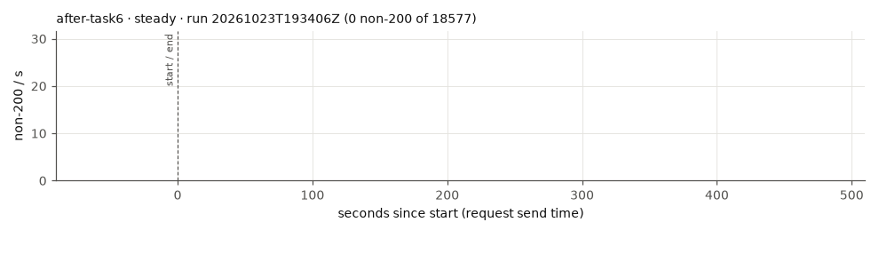
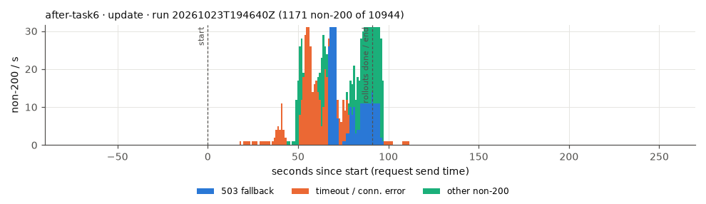
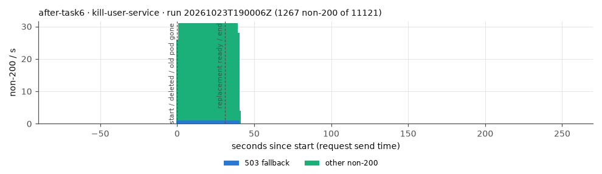
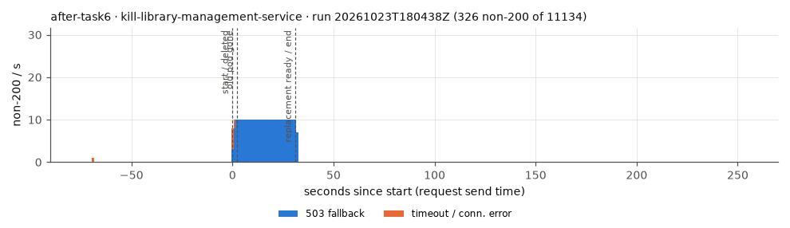
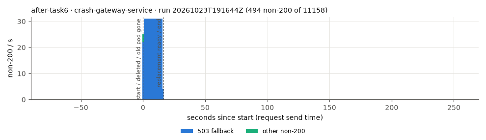
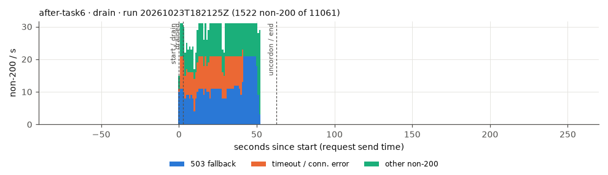
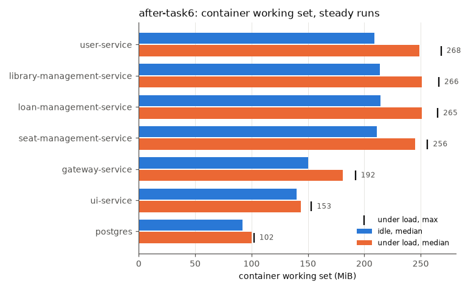

# after-task6

Commit `dd8c8e5a98c55c212d12e077bcbea2e8b1d57a7b`, RATE 30/s.

Mean over the completed runs, (min–max) where they differ. Latencies are for the read scenario.

| cell | runs | requests | non-200 | non-200 % | 503 | timeout/0 | other | longest error window s | recovery s | p50 ms | p95 ms | p99 ms | max ms | p95 after start ms | p99 after start ms | rollout s | new pod ready s | old pod gone s | errors after ready s | non-200 after ready | drain s | restarts |
|---|---|---|---|---|---|---|---|---|---|---|---|---|---|---|---|---|---|---|---|---|---|---|
| steady | 3 | 18583 (18572–18601) | 0.7 (0–2) | 0.00 (0.00–0.01) | 0 | 0.7 (0–2) | 0 | 0.7 (0–2) | 0 | 18 (17–20) | 217 (43–320) | 879 (164–1319) | 2100 (1049–2807) | 44 (26–60) | 335 (58–474) | – | – | – | – | – | – | 0 |
| update | 3 | 10974 (10944–11031) | 896 (271–1246) | 8.18 (2.46–11.38) | 325.3 (9–636) | 293 (75–414) | 277.7 (187–450) | 48 (11–77) | 97.3 (62–118) | 27 (24–29) | 5600 (2613–7448) | 8508 (5524–10000) | 10001 (10001–10001) | 6895 (3067–9009) | 8968 (6902–10000) | 79.5 (61.3–91) | – | – | – | – | – | 0 |
| kill-gateway-service | 3 | 11149 (11125–11161) | 545.3 (493–649) | 4.89 (4.42–5.83) | 541.3 (488–647) | 0 | 4 (2–5) | 18.7 (17–22) | 18.7 (17–22) | 21 (20–22) | 174 (64–384) | 750 (344–1458) | 1617 (1025–2673) | 38 (31–48) | 155 (100–247) | – | 17.9 (16.2–21.2) | 3.6 (3.1–3.9) | 0.7 (0.6–0.8) | 0 | – | 0 |
| kill-user-service | 3 | 11140 (11121–11162) | 1161.7 (951–1267) | 10.43 (8.52–11.39) | 37.7 (31–41) | 0 | 1124 (920–1226) | 38.3 (31–42) | 38.3 (31–42) | 19 (18–20) | 268 (47–391) | 978 (114–1457) | 2130 (842–3300) | 47 (30–56) | 84 (56–107) | – | 29.6 (26.4–31.2) | 1.4 (0.7–2.2) | 8.7 (4.6–10.8) | 250 (139–306) | – | 0 |
| kill-library-management-service | 3 | 11152 (11134–11161) | 325.3 (324–326) | 2.92 (2.90–2.93) | 317.3 (316–318) | 8 | 0 | 33.3 (33–34) | 33 | 20 (19–20) | 229 (58–519) | 780 (385–1561) | 10001 (10001–10001) | 53 (35–82) | 249 (114–380) | – | 28.0 (26.2–31.2) | 1.7 (1.4–2.2) | 5.0 (1.8–6.8) | 45.3 (15–65) | – | 0 |
| crash-gateway-service | 3 | 11149 (11129–11160) | 495 (493–498) | 4.44 (4.42–4.47) | 490.3 (485–495) | 0 | 4.7 (3–8) | 17 | 17 | 20 (19–20) | 62 (51–75) | 648 (311–1120) | 2038 (1273–3379) | 45 (38–57) | 477 (391–582) | – | 16.3 (16.2–16.4) | 0.6 (0.5–0.7) | 0.7 (0.6–0.8) | 0 | – | 0 |
| drain | 3 | 11114 (11061–11153) | 1520.3 (1441–1598) | 13.68 (12.95–14.33) | 849 (619–1019) | 135.7 (6–389) | 535.7 (410–683) | 54.3 (53–57) | 54 (52–57) | 22 (21–22) | 281 (93–586) | 3874 (669–10000) | 10001 (10001–10001) | 695 (139–1805) | 4005 (796–10001) | – | – | – | – | – | 1.9 (1.2–2.2) | 0 |

## Drain placement

| run | drained node | app pods on it at start | non-200 |
|---|---|---|---|
| 20261023T182125Z | kube03 | library-management-service seat-management-service user-service | 1522 |
| 20261023T192510Z | kube03 | library-management-service seat-management-service user-service | 1598 |
| 20261023T202915Z | kube03 | library-management-service seat-management-service user-service | 1441 |

## Memory (MiB, container working set)

idle = before k6 starts; load = from 60 s after k6 starts (steady runs); any_run = peak in any run.

| app | idle_median_mi | idle_p95_mi | idle_max_mi | load_median_mi | load_p95_mi | load_max_mi | any_run_max_mi | load_cpu_median_m |
|---|---|---|---|---|---|---|---|---|
| gateway-service | 150 | 154 | 154 | 181 | 186 | 192 | 226 | 138 |
| library-management-service | 214 | 216 | 216 | 251 | 257 | 266 | 291 | 117 |
| loan-management-service | 214.5 | 215 | 215 | 251 | 258 | 265 | 294 | 116 |
| postgres | 92 | 93 | 93 | 100 | 101 | 102 | 166 | 55 |
| seat-management-service | 211 | 212 | 212 | 245 | 252 | 256 | 282 | 99 |
| ui-service | 140 | 143 | 143 | 144 | 147 | 153 | 153 | 4 |
| user-service | 209 | 212 | 213 | 249 | 258 | 268 | 326 | 374 |

## Nodes under load (MiB, steady runs)

| node | node_median_mi | node_max_mi | app_pods_median_mi | app_pods_max_mi |
|---|---|---|---|---|
| kube01 | 1528 | 1552 | 0 | 0 |
| kube02 | 729 | 1835 | 101 | 1182 |
| kube03 | 1871 | 1931 | 1330 | 1351 |

## Plots

