# after-task7-8

Commit `6cf0d970899b3e92ccef2da78556a18925eeda5e`, RATE 30/s.

Mean over the completed runs, (min–max) where they differ. Latencies are for the read scenario.

| cell | runs | requests | non-200 | non-200 % | 503 | timeout/0 | other | longest error window s | recovery s | p50 ms | p95 ms | p99 ms | max ms | p95 after start ms | p99 after start ms | rollout s | new pod ready s | old pod gone s | errors after ready s | non-200 after ready | drain s | restarts |
|---|---|---|---|---|---|---|---|---|---|---|---|---|---|---|---|---|---|---|---|---|---|---|
| steady | 3 | 18535 (18492–18602) | 1.7 (0–5) | 0.01 (0.00–0.03) | 0 | 1.7 (0–5) | 0 | 1 (0–3) | 0 | 20 (19–20) | 967 (37–1755) | 2268 (82–3828) | 4365 (727–6222) | 752 (26–1574) | 2278 (41–3983) | – | – | – | – | – | – | 0 |
| update | 3 | 11020 (10924–11100) | 247.3 (1–733) | 2.26 (0.01–6.71) | 0.7 (0–1) | 189.3 (1–560) | 57.3 (0–172) | 18.3 (1–49) | 147 (83–254) | 31 (27–37) | 3405 (773–7706) | 6326 (3773–10000) | 8929 (8152–10002) | 4400 (1229–9792) | 6659 (4339–10000) | 127.5 (83.5–168.6) | – | – | – | – | – | 0 |
| kill-gateway-service | 3 | 11144 (11124–11156) | 543.3 (446–607) | 4.87 (4.01–5.44) | 543.3 (446–607) | 0 | 0 | 18 (15–20) | 20.3 (17–23) | 22 (22–22) | 110 (55–179) | 732 (225–1256) | 2708 (1614–4549) | 55 (35–70) | 605 (253–832) | – | 25.1 (21.5–27.4) | 17.1 (14–21.5) | 0 | 0 | – | 0 |
| kill-user-service | 3 | 11122 (11081–11151) | 775.3 (659–1001) | 6.98 (5.92–9.03) | 23.3 (18–31) | 12 (0–35) | 740 (613–970) | 25.7 (22–33) | 35.7 (32–43) | 22 (22–23) | 219 (58–406) | 1573 (373–3215) | 9061 (7182–10001) | 86 (41–144) | 366 (92–513) | – | 35.2 (26.6–42.3) | 13.6 (11.6–16.5) | 3.9 (0–6.2) | 110.3 (0–178) | – | 0 |
| kill-library-management-service | 3 | 11144 (11109–11162) | 255 (219–326) | 2.29 (1.96–2.92) | 254.3 (218–325) | 0.7 (0–1) | 0 | 26.7 (23–34) | 36.7 (33–44) | 22 (21–22) | 154 (51–359) | 640 (113–1691) | 8229 (4685–10001) | 38 (33–46) | 161 (67–345) | – | 31.5 (27.1–36.3) | 11.6 (11.3–12.1) | 5.1 (1.8–7.7) | 41.7 (10–65) | – | 0 |
| crash-gateway-service | 3 | 11148 (11124–11160) | 516.7 (464–622) | 4.64 (4.16–5.59) | 479.7 (422–587) | 0 | 37 (34–42) | 17.7 (16–21) | 18.7 (17–22) | 22 (22–23) | 128 (58–260) | 771 (262–1566) | 2312 (1273–4259) | 47 (37–58) | 395 (255–663) | – | 23.7 (21.7–27.3) | 0.7 (0.6–0.7) | 0 | 0 | – | 0 |
| drain | 3 | 10928 (10900–10970) | 1218 (812–1897) | 11.16 (7.40–17.40) | 448.3 (268–742) | 675 (260–1155) | 94.7 (0–284) | 50 (40–67) | 91 (67–117) | 29 (28–30) | 6500 (3974–9856) | 10000 (9999–10000) | 10001 (10001–10002) | 7135 (4820–10000) | 10000 (10000–10001) | – | – | – | – | – | 55.3 (51.3–58.9) | 0 |
| kill1-gateway-service | 3 | 11135 (11094–11162) | 0 | 0.00 | 0 | 0 | 0 | 0 | 0 | 22 (21–22) | 247 (53–474) | 1344 (171–2784) | 3262 (622–6734) | 44 (31–54) | 135 (63–176) | – | 18.3 (16.5–21.7) | 13.6 (13.2–13.9) | 0 | 0 | – | 0 |
| kill1-user-service | 3 | 11115 (11068–11140) | 0 | 0.00 | 0 | 0 | 0 | 0 | 0 | 21 (21–22) | 108 (52–207) | 1515 (253–3679) | 4744 (2674–8713) | 42 (32–56) | 255 (62–366) | – | 26.5 (26.4–26.5) | 11.5 (11.4–11.6) | 0 | 0 | – | 0 |
| crash1-gateway-service | 3 | 11153 (11146–11162) | 0 | 0.00 | 0 | 0 | 0 | 0 | 0 | 22 (21–22) | 196 (47–351) | 799 (116–1292) | 1813 (804–2387) | 35 (31–40) | 69 (56–85) | – | 20.0 (16.4–22.1) | 0.6 (0.5–0.6) | 0 | 0 | – | 0 |

## Drain placement

| run | drained node | app pods on it at start | non-200 |
|---|---|---|---|
| 20261023T220226Z | kube03 | gateway-service loan-management-service seat-management-service ui-service | 1897 |
| 20261023T231304Z | kube03 | gateway-service library-management-service user-service | 812 |
| 20261024T002235Z | kube03 | gateway-service library-management-service user-service | 945 |

## Memory (MiB, container working set)

idle = before k6 starts; load = from 60 s after k6 starts (steady runs); any_run = peak in any run.

| app | idle_median_mi | idle_p95_mi | idle_max_mi | load_median_mi | load_p95_mi | load_max_mi | any_run_max_mi | load_cpu_median_m |
|---|---|---|---|---|---|---|---|---|
| gateway-service | 150 | 151 | 151 | 178 | 186 | 210 | 210 | 79 |
| library-management-service | 215 | 217 | 217 | 258 | 270 | 277 | 282 | 125 |
| loan-management-service | 215 | 216 | 216 | 258 | 266 | 275 | 276 | 114 |
| postgres | 101 | 101 | 101 | 113 | 116 | 117 | 183 | 57 |
| seat-management-service | 213 | 214 | 214 | 252 | 261 | 271 | 277 | 106 |
| ui-service | 140 | 143 | 143 | 143 | 147 | 148 | 150 | 4 |
| user-service | 209.5 | 211 | 211 | 244 | 250 | 254 | 269 | 226 |

## Nodes under load (MiB, steady runs)

| node | node_median_mi | node_max_mi | app_pods_median_mi | app_pods_max_mi |
|---|---|---|---|---|
| kube01 | 1622 | 1651 | 0 | 0 |
| kube02 | 742 | 1852 | 115 | 1192 |
| kube03 | 2328 | 2396 | 1769 | 1824 |

## Plots

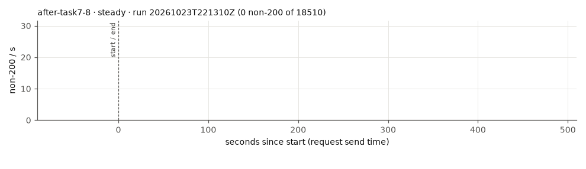
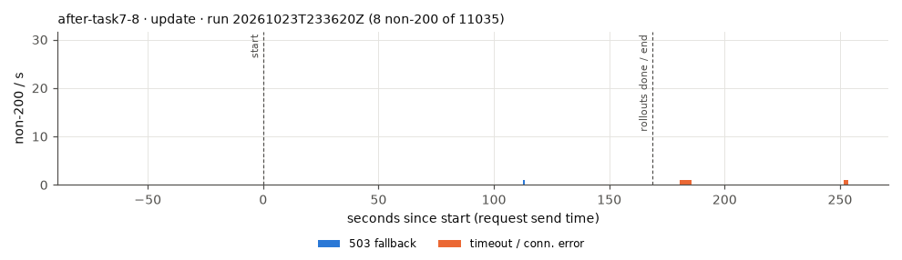
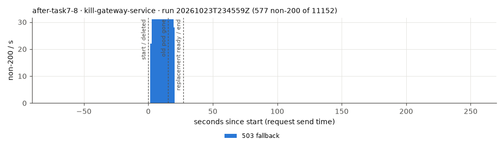
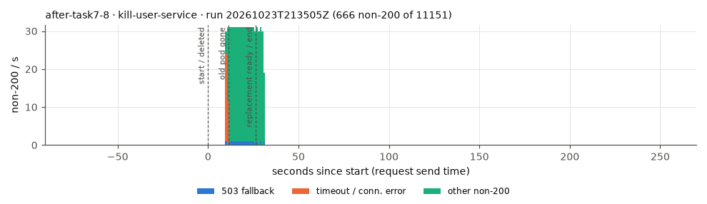
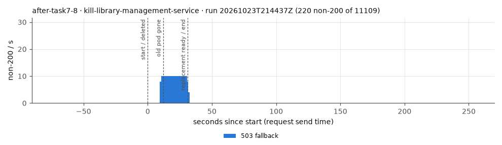
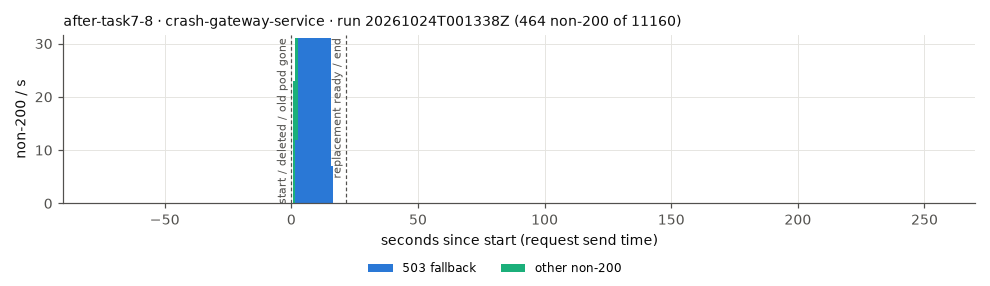
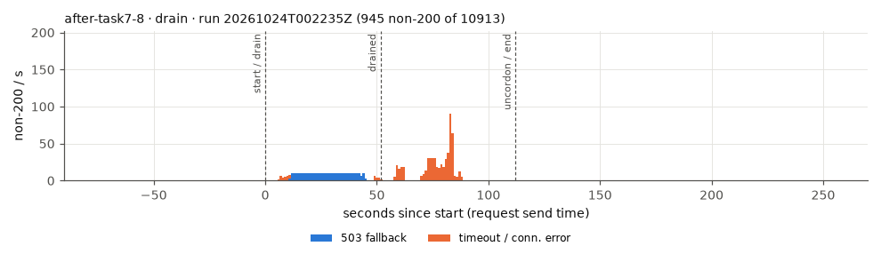
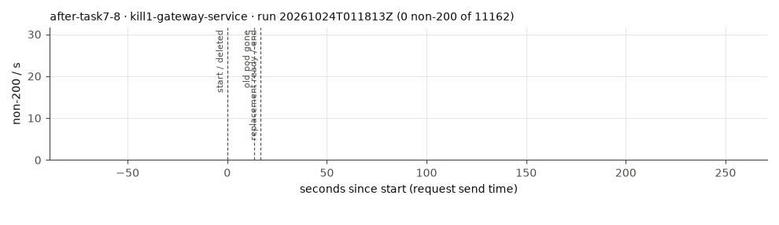
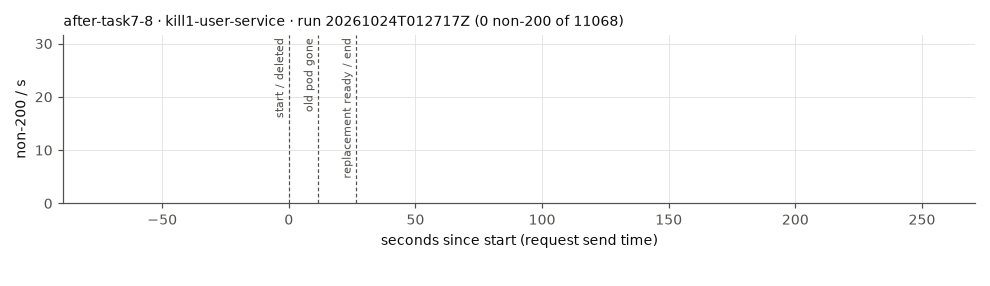
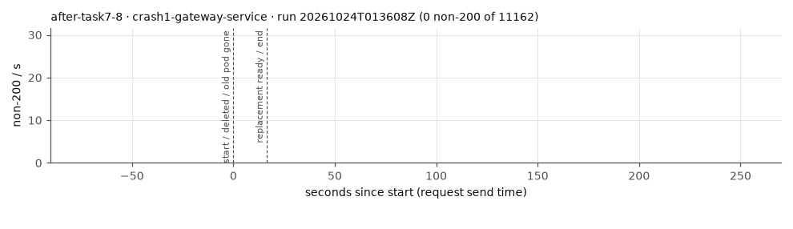

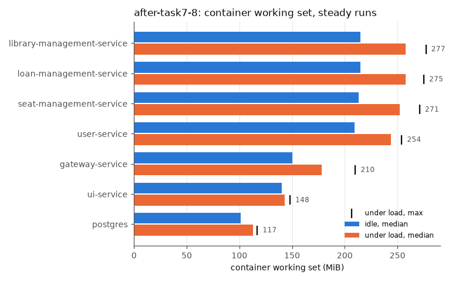
