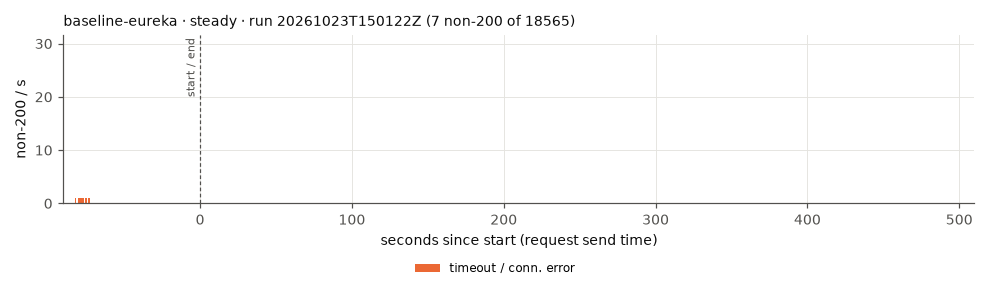
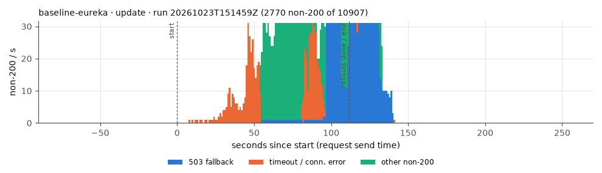
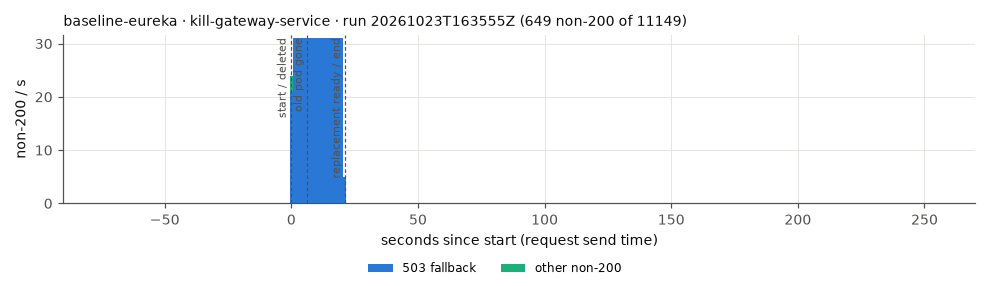
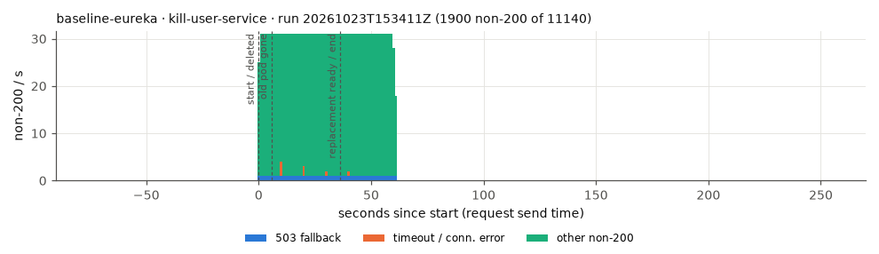
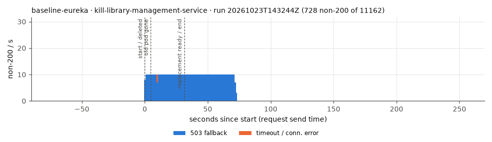
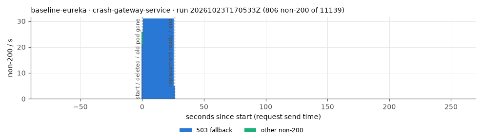
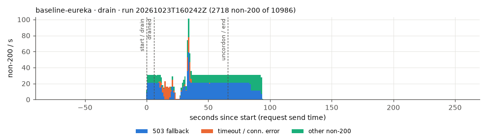
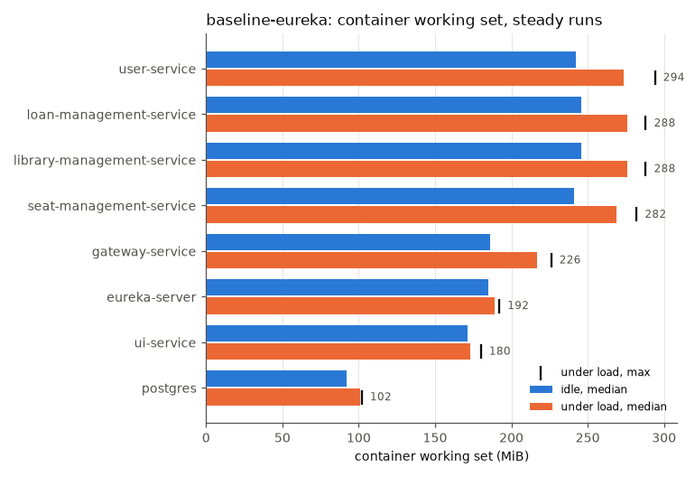

# baseline-eureka

Commit `442f087b57a6252df2a355187672dda41bb5579c`, RATE 30/s.

Mean over the completed runs, (min–max) where they differ. Latencies are for the read scenario.

| cell | runs | requests | non-200 | non-200 % | 503 | timeout/0 | other | longest error window s | recovery s | p50 ms | p95 ms | p99 ms | max ms | p95 after start ms | p99 after start ms | rollout s | new pod ready s | old pod gone s | errors after ready s | non-200 after ready | drain s | restarts |
|---|---|---|---|---|---|---|---|---|---|---|---|---|---|---|---|---|---|---|---|---|---|---|
| steady | 3 | 18580 (18565–18602) | 36.3 (2–100) | 0.20 (0.01–0.54) | 33.7 (0–100) | 2.3 (0–7) | 0.3 (0–1) | 5 (1–10) | 2.3 (0–7) | 19 (18–20) | 200 (36–308) | 986 (72–1502) | 2341 (954–3047) | 34 (26–40) | 253 (43–444) | – | – | – | – | – | – | 0 |
| update | 3 | 10944 (10896–11029) | 2861.3 (2267–3547) | 26.17 (20.55–32.55) | 1598.7 (1124–1957) | 544.7 (101–943) | 718 (451–1056) | 119.3 (91–146) | 146.3 (126–171) | 28 (26–31) | 7973 (3920–10000) | 9362 (8083–10001) | 10008 (10001–10021) | 8363 (5088–10000) | 9800 (9400–10001) | 101.7 (82.1–111.6) | – | – | – | – | – | 0.7 (0–1) |
| kill-gateway-service | 3 | 11145 (11137–11150) | 699.3 (645–804) | 6.28 (5.78–7.22) | 694.3 (638–799) | 0 | 5 (3–7) | 23.7 (22–27) | 23.7 (22–27) | 21 (21–22) | 60 (54–68) | 386 (261–489) | 2385 (2082–2810) | 40 (38–43) | 296 (151–553) | – | 23.1 (21.3–26.4) | 6.7 (6.3–7.3) | 0.6 (0.5–0.7) | 0 | – | 0 |
| kill-user-service | 3 | 11145 (11139–11157) | 2098.3 (1885–2510) | 18.83 (16.90–22.53) | 67.3 (59–81) | 8.7 (7–10) | 2022.3 (1817–2419) | 68.7 (62–82) | 68.7 (62–82) | 20 (19–22) | 243 (49–355) | 950 (111–1421) | 10001 (10001–10001) | 46 (33–55) | 89 (71–117) | – | 33.0 (26.4–36.4) | 4.6 (4–4.9) | 35.6 (25.7–45.6) | 1078.7 (781–1384) | – | 0 |
| kill-library-management-service | 3 | 11162 (11161–11162) | 713 (670–741) | 6.39 (6.00–6.64) | 707 (664–732) | 6 (3–9) | 0 | 72.3 (68–75) | 72.3 (68–75) | 22 (21–22) | 46 (44–48) | 95 (79–114) | 10001 (10001–10001) | 32 (31–32) | 56 (50–62) | – | 31.3 (31.2–31.4) | 4.7 (4.7–4.8) | 41.0 (36.8–43.6) | 402 (360–429) | – | 0 |
| crash-gateway-service | 3 | 11143 (11139–11149) | 754 (649–807) | 6.77 (5.82–7.24) | 749.7 (648–801) | 0 | 4.3 (1–7) | 25.3 (22–27) | 25.3 (22–27) | 22 (21–22) | 150 (117–205) | 649 (587–714) | 2362 (2232–2562) | 42 (33–51) | 512 (261–675) | – | 24.7 (21.3–26.5) | 0.6 (0.5–0.6) | 0.6 (0.5–0.7) | 0 | – | 0 |
| drain | 3 | 11015 (10925–11133) | 2747 (2551–2972) | 24.93 (23.35–26.70) | 1484.7 (1325–1611) | 288.7 (13–644) | 973.7 (389–1634) | 95.3 (93–98) | 95.3 (93–98) | 24 (23–24) | 4054 (207–10000) | 7090 (1271–10000) | 10004 (10001–10010) | 4450 (360–10000) | 7270 (1811–10000) | – | – | – | – | – | 5.9 (5.2–7.2) | 0 |

## Drain placement

| run | drained node | app pods on it at start | non-200 |
|---|---|---|---|
| 20261023T145108Z | kube03 | gateway-service library-management-service seat-management-service user-service | 2551 |
| 20261023T160242Z | kube03 | eureka-server library-management-service seat-management-service user-service | 2718 |
| 20261023T171502Z | kube03 | eureka-server library-management-service seat-management-service user-service | 2972 |

## Memory (MiB, container working set)

idle = before k6 starts; load = from 60 s after k6 starts (steady runs); any_run = peak in any run.

| app | idle_median_mi | idle_p95_mi | idle_max_mi | load_median_mi | load_p95_mi | load_max_mi | any_run_max_mi | load_cpu_median_m |
|---|---|---|---|---|---|---|---|---|
| eureka-server | 185 | 186 | 186 | 189 | 192 | 192 | 192 | 5 |
| gateway-service | 186 | 188 | 188 | 217 | 222 | 226 | 286 | 144.5 |
| library-management-service | 246 | 246 | 246 | 276 | 283 | 288 | 326 | 101 |
| loan-management-service | 246 | 247 | 247 | 276 | 281 | 288 | 368 | 119 |
| postgres | 92 | 93 | 93 | 101 | 102 | 102 | 149 | 55 |
| seat-management-service | 241 | 242 | 242 | 269 | 274 | 282 | 321 | 91 |
| ui-service | 171 | 172 | 172 | 173 | 175 | 180 | 180 | 4 |
| user-service | 242 | 245 | 245 | 273.5 | 283 | 294 | 353 | 379 |

## Nodes under load (MiB, steady runs)

| node | node_median_mi | node_max_mi | app_pods_median_mi | app_pods_max_mi |
|---|---|---|---|---|
| kube01 | 1516 | 1551 | 0 | 0 |
| kube02 | 721 | 1390 | 101 | 764 |
| kube03 | 2221 | 2270 | 1684 | 1707 |

## Plots

