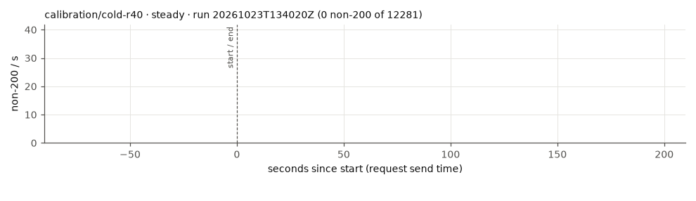
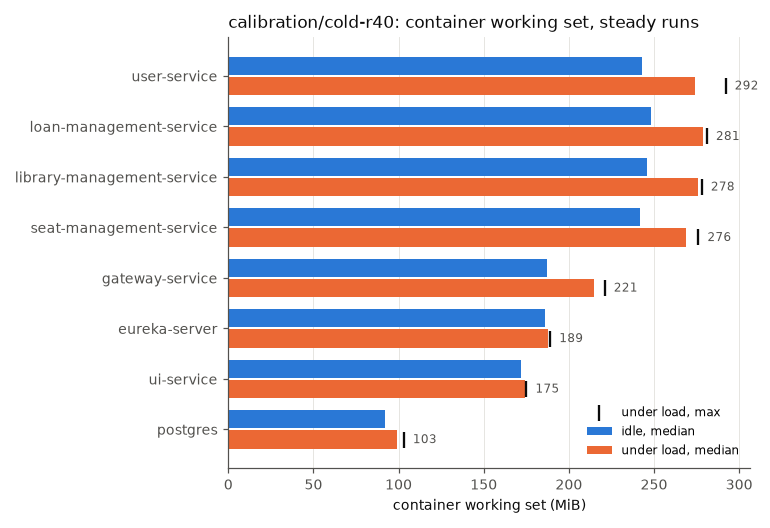

# calibration/cold-r40

Commit ``, RATE 40/s.

Mean over the completed runs, (min–max) where they differ. Latencies are for the read scenario.

| cell | runs | requests | non-200 | non-200 % | 503 | timeout/0 | other | longest error window s | recovery s | p50 ms | p95 ms | p99 ms | max ms | p95 after start ms | p99 after start ms | restarts |
|---|---|---|---|---|---|---|---|---|---|---|---|---|---|---|---|---|
| steady | 1 | 12281 | 0 | 0.00 | 0 | 0 | 0 | 0 | 0 | 21 | 246 | 1181 | 2280 | 33 | 242 | 0 |

## Memory (MiB, container working set)

idle = before k6 starts; load = from 60 s after k6 starts (steady runs); any_run = peak in any run.

| app | idle_median_mi | idle_p95_mi | idle_max_mi | load_median_mi | load_p95_mi | load_max_mi | any_run_max_mi | load_cpu_median_m |
|---|---|---|---|---|---|---|---|---|
| eureka-server | 186 | 186 | 186 | 188 | 189 | 189 | 189 | 10 |
| gateway-service | 187 | 187 | 187 | 215 | 220.6 | 221 | 221 | 164 |
| library-management-service | 246 | 246 | 246 | 276 | 278 | 278 | 278 | 152 |
| loan-management-service | 248 | 248 | 248 | 279 | 281 | 281 | 281 | 217 |
| postgres | 92 | 92 | 92 | 99 | 101.8 | 103 | 103 | 62 |
| seat-management-service | 242 | 242 | 242 | 269 | 271 | 276 | 276 | 145 |
| ui-service | 172 | 172 | 172 | 174 | 175 | 175 | 175 | 7 |
| user-service | 243 | 243 | 243 | 274 | 286.8 | 292 | 292 | 434 |

## Nodes under load (MiB, steady runs)

| node | node_median_mi | node_max_mi | app_pods_median_mi | app_pods_max_mi |
|---|---|---|---|---|
| kube01 | 1505 | 1510 | 0 | 0 |
| kube02 | 1372 | 1377 | 740 | 747 |
| kube03 | 1557 | 1571 | 1035 | 1055 |

## Plots

