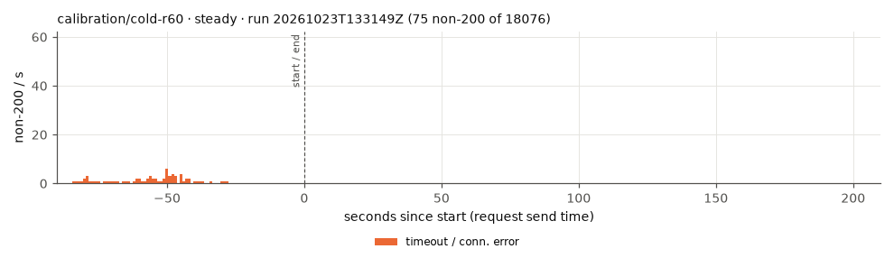
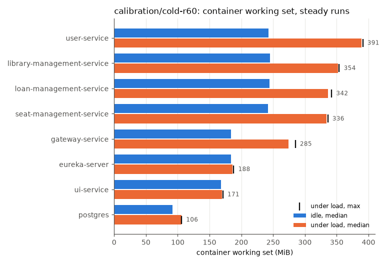

# calibration/cold-r60

Commit ``, RATE 60/s.

Mean over the completed runs, (min–max) where they differ. Latencies are for the read scenario.

| cell | runs | requests | non-200 | non-200 % | 503 | timeout/0 | other | longest error window s | recovery s | p50 ms | p95 ms | p99 ms | max ms | p95 after start ms | p99 after start ms | restarts |
|---|---|---|---|---|---|---|---|---|---|---|---|---|---|---|---|---|
| steady | 1 | 18076 | 75 | 0.41 | 0 | 75 | 0 | 16 | 0 | 22 | 4716 | 7663 | 10001 | 53 | 381 | 0 |

## Memory (MiB, container working set)

idle = before k6 starts; load = from 60 s after k6 starts (steady runs); any_run = peak in any run.

| app | idle_median_mi | idle_p95_mi | idle_max_mi | load_median_mi | load_p95_mi | load_max_mi | any_run_max_mi | load_cpu_median_m |
|---|---|---|---|---|---|---|---|---|
| eureka-server | 184 | 184 | 184 | 186 | 187.6 | 188 | 188 | 11 |
| gateway-service | 184 | 184 | 184 | 274 | 284.6 | 285 | 285 | 216 |
| library-management-service | 245 | 245 | 245 | 352 | 354 | 354 | 354 | 203 |
| loan-management-service | 244 | 244 | 244 | 336 | 341.6 | 342 | 342 | 303 |
| postgres | 92 | 93 | 93 | 106 | 106 | 106 | 106 | 83 |
| seat-management-service | 242 | 242 | 242 | 334 | 335.6 | 336 | 336 | 198 |
| ui-service | 168 | 168 | 168 | 170 | 171 | 171 | 171 | 8 |
| user-service | 243 | 244.5 | 245 | 389 | 390.6 | 391 | 391 | 479 |

## Nodes under load (MiB, steady runs)

| node | node_median_mi | node_max_mi | app_pods_median_mi | app_pods_max_mi |
|---|---|---|---|---|
| kube01 | 1590 | 1624 | 0 | 0 |
| kube02 | 1477 | 1504 | 798 | 804 |
| kube03 | 1865 | 1884 | 1350 | 1360 |

## Plots

