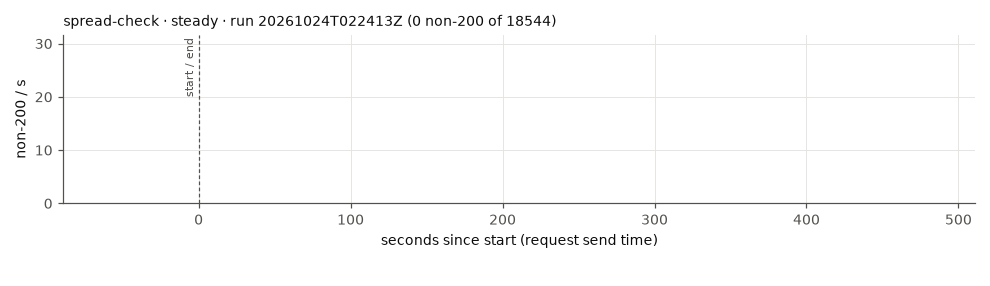
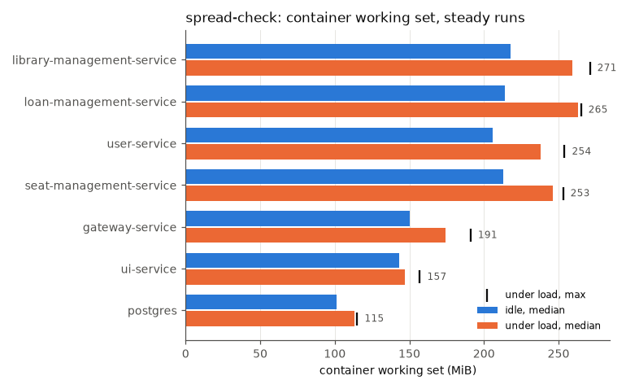

# spread-check

Commit ``, RATE 30/s.

Mean over the completed runs, (min–max) where they differ. Latencies are for the read scenario.

| cell | runs | requests | non-200 | non-200 % | 503 | timeout/0 | other | longest error window s | recovery s | p50 ms | p95 ms | p99 ms | max ms | p95 after start ms | p99 after start ms | restarts |
|---|---|---|---|---|---|---|---|---|---|---|---|---|---|---|---|---|
| steady | 1 | 18544 | 0 | 0.00 | 0 | 0 | 0 | 0 | 0 | 19 | 45 | 1572 | 7661 | 27 | 46 | 0 |

## Memory (MiB, container working set)

idle = before k6 starts; load = from 60 s after k6 starts (steady runs); any_run = peak in any run.

| app | idle_median_mi | idle_p95_mi | idle_max_mi | load_median_mi | load_p95_mi | load_max_mi | any_run_max_mi | load_cpu_median_m |
|---|---|---|---|---|---|---|---|---|
| gateway-service | 150 | 150 | 150 | 174 | 180 | 191 | 191 | 78 |
| library-management-service | 218 | 218.7 | 219 | 259 | 262 | 271 | 271 | 85 |
| loan-management-service | 214 | 214 | 214 | 263 | 264 | 265 | 265 | 88 |
| postgres | 101 | 102 | 102 | 113 | 113 | 115 | 115 | 47 |
| seat-management-service | 213 | 213 | 213 | 246 | 251.6 | 253 | 253 | 123 |
| ui-service | 143 | 143 | 143 | 147 | 148 | 157 | 157 | 3 |
| user-service | 206 | 210 | 210 | 238 | 247 | 254 | 254 | 224 |

## Nodes under load (MiB, steady runs)

| node | node_median_mi | node_max_mi | app_pods_median_mi | app_pods_max_mi |
|---|---|---|---|---|
| kube01 | 1666 | 1670 | 0 | 0 |
| kube02 | 1411 | 1426 | 774 | 792 |
| kube03 | 1640 | 1656 | 1079 | 1103 |

## Plots

